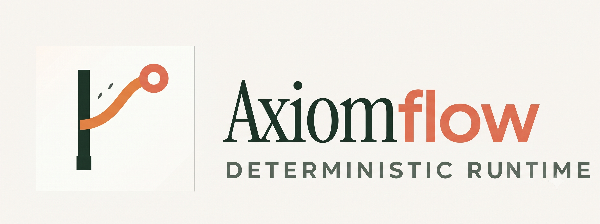

<div align="center">
<br />
<div align="center">
    

  <h3 align="center">Intelligent Business Automation Workflow</h3>
</div>


[](https://fastapi.tiangolo.com)
[](https://react.dev)
[](https://python.org)

</div>

---

### Project Status: Active

---

##  Problem Summary

Small and medium-sized businesses (SMBs) run daily operations across emails, spreadsheets, documents, messaging apps, and separate software tools. Employees lose significant time searching for information, cross-checking records, tracking pending tasks, chasing stakeholders, and copying data between systems.

Traditional automation (fixed if-then rules) cannot handle this well because real business workflows are dynamic. The next step often depends on information gathered from several sources, and conditions change while the work is in progress.


###  Product Vision
An agentic AI system that understands a business objective, gathers the information it needs from multiple sources, plans the steps, executes them with minimal manual effort, and asks a human for approval when stakes are high. It handles complete multi-step workflows, not single questions.

---

## 3. Target Users

- **Primary:** Operations or finance staff at an SMB who handle follow-ups, reminders, and record checks.
- **Secondary:** Team leads and managers who approve actions and review progress.
- **Demo audience:** Hackathon judges evaluating the agentic behavior and reliability of the system.

---

## Project Structure

```text
business_automation_workflow/
├── backend/
|
├── frontend/                   
│   ├── src/
|   |   |── app/
│   │   ├── components/   
|   |   |       |── ArchitectureShowcase.tsx      
│   │   ├── lib/                # Firebase client, API fetchers, auth context
│   │   ├── pages/              # 12 application pages (Dashboard, CreditProfile, Schemes, etc.)
│   │   └── index.css           # FinBridge design system tokens (FinGreen, FinAmber, Slate Glass)
│   ├── package.json            # Node.js dependencies
│   └── vite.config.ts          # Vite build configuration
├── screenshots/                # High-resolution screenshots of the FinBridge platform
├── docs/                       # Architecture, API specifications, and judge Q&A
├── Design.md                   # Visual design system specifications
├── PROJECT.md                  # Comprehensive platform reference & developer guide
├── script.md                   # 12-page step-by-step hackathon demo presentation script
└── README.md                   # This file
```
---

<div align="center">

Made with ❤️ by Yash Chillal**

</div>