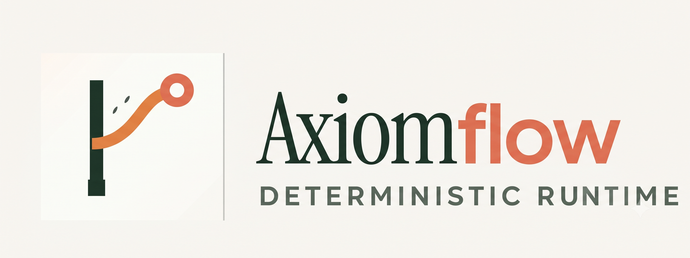
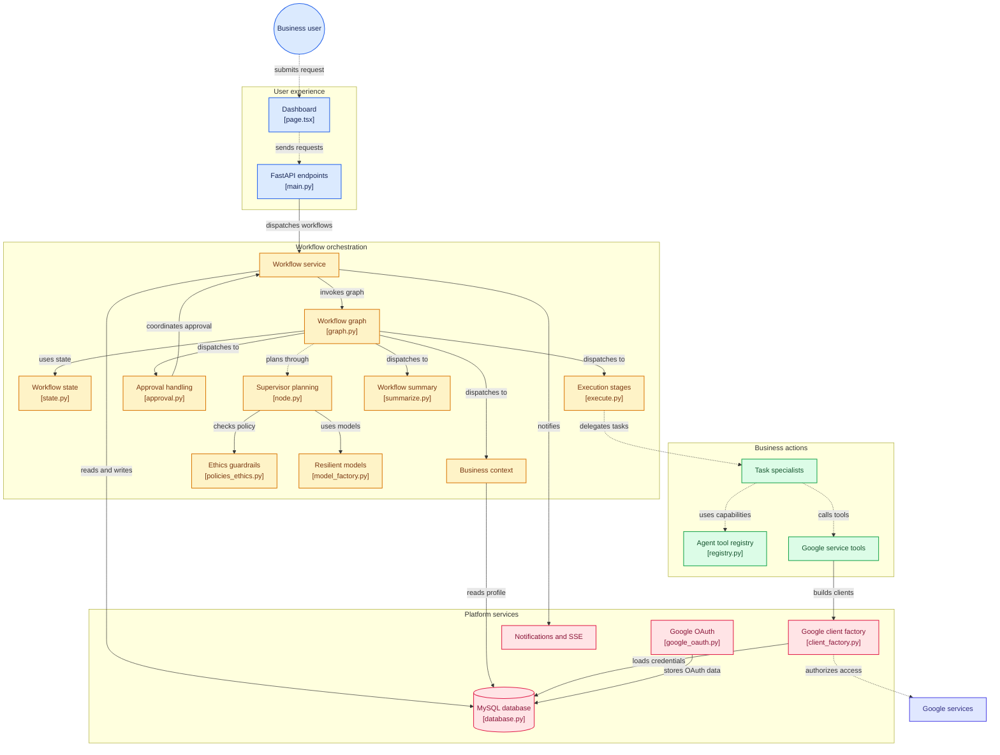

<div align="center">
  <br />
  

  <h3>Autonomous Business Automation & Multi-Agent Orchestration Platform</h3>
  <p><em>Streamlining enterprise operations across Google Workspace with deterministic LangGraph orchestration, multi-LLM resilience, and human-in-the-loop governance.</em></p>

[](https://fastapi.tiangolo.com)
[](https://nextjs.org)
[](https://www.typescriptlang.org)
[](https://python.org)
[](https://langchain.com)
[](https://mysql.com)

</div>

---

### Project Status: Active

---

## Problem Statement

Small and medium-sized businesses (SMBs) run day-to-day operations fragmented across emails, spreadsheets, documents, calendars, and siloed software tools. Knowledge workers lose significant time manually tracking pending tasks, cross-referencing customer and financial records, chasing stakeholders for follow-ups, and copy-pasting data between disconnected systems.

Traditional automation tools (rigid if-then rules / basic RPA) cannot adequately handle dynamic enterprise workflows because real business processes are contextual and nondeterministic:
- The next operational step often depends on synthesizing data gathered dynamically across disparate sources (e.g., matching a client payment record in Google Sheets with a thread in Gmail).
- Incoming business requests in natural language are frequently underspecified or ambiguous.
- Fully autonomous AI agents operating without safeguards present significant risks, including hallucinations, unauthorized data modifications, policy violations, and accidental dispatches of sensitive emails.

---

## Product Summary & Vision

**AxiomFlow** is an enterprise-grade agentic AI orchestration platform designed to transform natural language business objectives into safe, transparent, and deterministic execution pipelines across **Google Workspace** (Gmail, Google Sheets, Google Docs, and Google Calendar).

Rather than granting an LLM unconstrained autonomy, AxiomFlow implements a **supervisor-governed multi-agent system** powered by **LangGraph**. The system autonomously retrieves business context, validates ethics and compliance policies, prompts the user for clarification when critical details are missing, plans optimal action steps, delegates tasks to domain specialists, and enforces mandatory **Human-in-the-Loop (HITL)** approval before any consequential or outward-facing action is taken.

### Key Capabilities
- **Natural Language Workflow Execution:** Converts complex plain-English requests (e.g., *"Audit overdue invoices in our client sheet, generate a summary doc, schedule a follow-up meeting, and draft tailored reminders"*) into structured multi-step plans.
- **Interactive Clarification (Pre-Execution HITL):** If an objective is underspecified (e.g., missing recipient email, event duration, or target sheet), the supervisor detects the gap and prompts the user with dynamic input cards before proceeding.
- **Strict Human-in-the-Loop (HITL) Governance:** High-stakes actions (such as sending emails or executing irreversible data writes) are held in an approval state. Users can review, edit, approve, or reject actions directly from the dashboard.
- **Provider-Agnostic LLM Resilience:** A centralized model factory supports multiple LLM providers (Google Gemini, Groq, and local Ollama) with automated fallbacks to protect against downtime and rate limits.
- **Enterprise Multi-Tenant Security & Scoped OAuth:** Google OAuth 2.0 with per-tenant encrypted credential storage (Fernet token vault) and strict least-privilege permission checks.
- **Real-Time Observability & Telemetry:** Full step-by-step audit logging into MySQL, real-time status streaming via Server-Sent Events (SSE), and desktop/browser notification alerts.

---

## System Architecture

[](https://gitdiagram.com/yashuu05/axiomflow?utm_source=readme&utm_medium=badge)



---

## ⚙️ Core Technical Highlights

### 1. State Machine Orchestration (LangGraph & LangChain)
- State transitions are managed as a deterministic acyclic directed graph via LangGraph (`StateGraph`).
- Pipeline nodes encompass:
  1. `retrieve_context`: Fetches business metadata, operational timezone, and registered profile.
  2. `understand`: Evaluates request feasibility, performs ethics and security policy screening, and identifies missing parameters.
  3. `clarify_hitl`: Pauses execution if key parameters are absent, rendering an interactive input card on the UI.
  4. `plan`: Breaks high-level objectives into sequential specialist actions.
  5. `execute_sheet` / `execute_docs` / `execute_calendar`: Executes Google Workspace actions through typed tools.
  6. `draft_email` / `approval_hitl`: Uses the Content Specialist to compose emails and halts for human sign-off before dispatching via Gmail.
  7. `summarize`: Generates an executive summary of completed operations and outcome telemetry.

### 2. Multi-Agent Specialist Division
- **Supervisor Agent:** Deconstructs goals, verifies compliance against corporate ethics and safety constraints, manages replanning, and synthesizes step execution.
- **Content Agent:** Drafts professional, context-rich emails and document copy tailored to the recipient persona and tone requirements.
- **Sheet Agent:** Parses spreadsheet data, inspects headers, filters rows, updates records, and creates new data sheets.
- **Docs Agent:** Creates structured Google Documents, appends meeting notes, logs records, and formats executive briefs.
- **Calendar Agent:** Validates schedule availability, handles conflicts, and books Google Calendar events with automated Google Meet conferencing.

### 3. Enterprise Integration & Security
- **OAuth 2.0 Integration:** Multi-tenant token management storing encrypted access and refresh tokens.
- **Token Vault:** Uses Python cryptography (Fernet AES) to securely encrypt sensitive OAuth tokens at rest in MySQL.
- **Role-Based Access & Policy Enforcement:** Safeguards against prompt injection, unauthorized financial commitments, and high-risk communication dispatches.

---

## Project Structure

```text
business_automation_workflow/
├── backend/
│   ├── agents/
│   │   ├── nodes/              # LangGraph execution nodes (understand, plan, execute, approval, etc.)
│   │   ├── specialists/        # Specialized agents (calendar, content, docs, sheet)
│   │   ├── supervisor/         # Central supervisor logic and sufficiency evaluation
│   │   ├── tools/              # Tool registry and capability mappings
│   │   ├── config.py           # Agent and model configurations
│   │   ├── graph.py            # LangGraph state machine definitions and routing logic
│   │   ├── model_factory.py    # Multi-provider LLM factory (Gemini, Groq, Ollama)
│   │   ├── policies_ethics.py  # Safety guardrails, prompt defense, and policy filters
│   │   └── state.py            # Typed state schemas for workflow orchestration
│   ├── tests/                  # Integration and unit test suite
│   ├── tools/                  # Google Workspace API integration tools (Gmail, Calendar, Sheets, Docs)
│   ├── create_tables.py        # Database schema initialization and migration scripts
│   ├── database.py             # Database connection pool manager
│   ├── google_oauth.py         # Google OAuth 2.0 endpoints and callback handlers
│   ├── main.py                 # FastAPI application and endpoint definitions
│   ├── notification_service.py # Desktop notifications (Plyer) & Server-Sent Events (SSE)
│   ├── token_vault.py          # Fernet cryptographic token encryption vault
│   └── workflow_service.py     # Real-time workflow dispatch, HITL signaling, and logging
├── frontend/
│   ├── src/
│   │   ├── app/                # Next.js App Router (Landing page, Auth, Dashboard)
│   │   │   ├── dashboard/      # Interactive dashboard page
│   │   │   ├── signin/         # User authentication page
│   │   │   └── signup/         # Business registration page
│   │   └── components/         # Modular React components
│   │       ├── dashboard/      # Workflow timeline, step detail, inline HITL cards, logs, notifications
│   │       ├── ArchitectureShowcase.tsx
│   │       ├── InteractiveSandbox.tsx
│   │       └── Navbar.tsx, HeroSection.tsx, etc.
│   ├── public/                 # Static assets, branding, and logos
│   ├── package.json            # Frontend dependencies (Next.js 16, React 19, Tailwind CSS)
│   └── tsconfig.json           # TypeScript configuration
├── docs/                       # Architecture specifications, PRDs, and implementation guides
├── requirements.txt            # Python dependencies
└── README.md                   # This file
```

---

## Technology Stack

| Layer | Technology | Purpose |
|---|---|---|
| **Frontend** | Next.js 16 (App Router), React 19, TypeScript, Tailwind CSS | High-performance interactive dashboard, real-time workflow visualizer, and HITL decision cards |
| **Backend API** | FastAPI (Async Python 3.11+), Pydantic v2 | High-throughput async REST API, OAuth router, SSE real-time streaming |
| **Agentic Framework** | LangChain, LangGraph | Stateful workflow routing, cyclic graph execution, checkpointing, multi-agent coordination |
| **LLM Providers** | Google Gemini (`gemini-2.5-flash`), Groq (`llama-3.3-70b`), Ollama | Resilient model fallback layer with centralized factory architecture |
| **Third-Party APIs** | Google Workspace APIs (Gmail, Drive, Sheets, Docs, Calendar) | Native enterprise tool execution via authenticated Google OAuth 2.0 |
| **Database** | MySQL (PyMySQL) | Relational persistence for user accounts, business profiles, workflow state, and step audit logs |
| **Security** | Fernet (AES-128-CBC / HMAC-SHA256), Bcrypt | At-rest OAuth token encryption and secure credential hashing |
| **Notifications** | Server-Sent Events (SSE), Plyer | Real-time streaming status updates to frontend and native OS desktop alerts |

---

## Getting Started

### Prerequisites
- **Python 3.11+** installed
- **Node.js 18+** & **npm** installed
- **MySQL Server** installed and running
- **Google Cloud Console Project** with OAuth 2.0 Credentials enabled for:
  - Gmail API
  - Google Calendar API
  - Google Sheets API
  - Google Docs API
  - Google Drive API
- API Keys for **Gemini** and/or **Groq** (or a local **Ollama** instance)

---

### Backend Setup

1. **Navigate to the backend directory and activate a virtual environment:**
   ```bash
   cd backend
   python -m venv .venv
   # Windows:
   .venv\Scripts\activate
   # macOS/Linux:
   source .venv/bin/activate
   ```

2. **Install dependencies:**
   ```bash
   pip install -r ../requirements.txt
   ```

3. **Configure Environment Variables:**
   Create a `.env` file in the project root (or inside `backend/`):
   ```env
   # Database Configuration
   DB_HOST=localhost
   DB_PORT=3306
   DB_USER=root
   DB_PASSWORD=your_password
   DB_NAME=axiomflow_db

   # LLM Providers
   DEFAULT_LLM_PROVIDER=gemini
   GEMINI_API_KEY=your_gemini_api_key
   GROQ_API_KEY=your_groq_api_key

   # Google OAuth 2.0
   GOOGLE_CLIENT_ID=your_google_client_id.apps.googleusercontent.com
   GOOGLE_CLIENT_SECRET=your_google_client_secret
   GOOGLE_REDIRECT_URI=http://localhost:8000/auth/google/callback

   # Security
   TOKEN_ENCRYPTION_KEY=your_fernet_32_byte_base64_key
   ```

4. **Initialize Database Tables:**
   ```bash
   python create_tables.py
   ```

5. **Start the FastAPI server:**
   ```bash
   python main.py
   # Or using uvicorn directly:
   uvicorn main:app --reload --port 8000
   ```
   The API will be accessible at `http://localhost:8000` (Swagger docs at `/docs`).

---

### Frontend Setup

1. **Navigate to the frontend directory:**
   ```bash
   cd frontend
   ```

2. **Install dependencies:**
   ```bash
   npm install
   ```

3. **Configure Frontend Environment:**
   Create a `.env.local` file in `frontend/`:
   ```env
   NEXT_PUBLIC_API_URL=http://localhost:8000
   ```

4. **Run the Next.js development server:**
   ```bash
   npm run dev
   ```
   Open `http://localhost:3000` in your browser.

---

## Testing & Verification

AxiomFlow features a comprehensive test suite covering unit operations, multi-agent workflows, and end-to-end integration:

```bash
# Run unit & agent pipeline tests
pytest backend/tests/test_agent_fundamentals.py
pytest backend/tests/test_sheets_crud_mcp.py
pytest backend/tests/test_calendar_lifecycle_mcp.py
pytest backend/tests/test_docs_agent_mcp.py

# Test HITL Clarification & Approval pipelines
pytest backend/tests/test_clarification_hitl_workflow.py
pytest backend/tests/test_policies_ethics_guardrails.py
```

---

<div align="center">

Made with ❤️ by **Yash Chillal**

</div>
