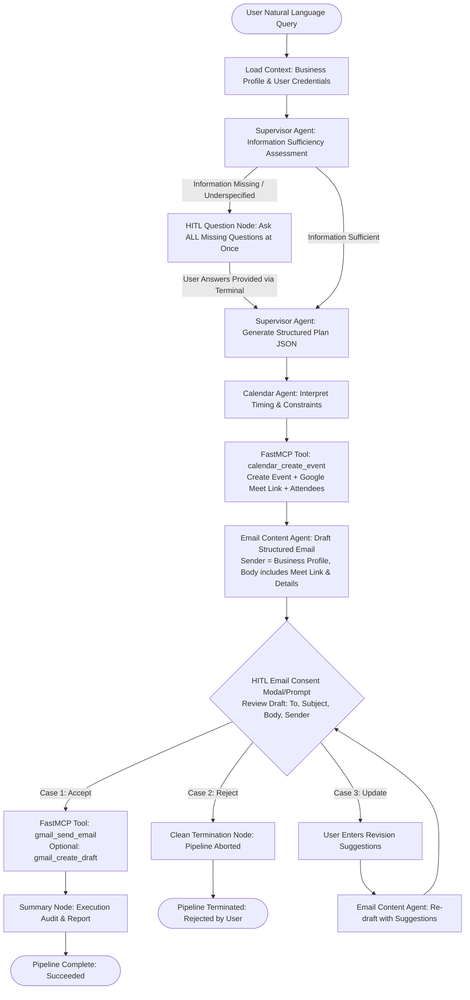
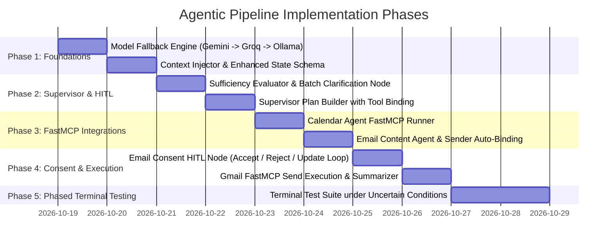

# Implementation Plan: End-to-End Agentic Pipeline with FastMCP Tool Integration

## 1. Executive Summary & Objectives

### 1.1 Context & Current Milestone
- **Completed**: Independent FastMCP tools for Google Gmail, Calendar, and Sheets have been successfully developed and tested for CRUD operations using OAuth 2.0 credentials (`test_send_email_mcp.py`, `test_calendar_lifecycle_mcp.py`, `test_sheets_crud_mcp.py`).
- **Completed**: Supervisor Agent planning with streaming reasoning and Email Content Agent with `Asia/Kolkata` temporal awareness have been verified with Gemini 3.8 Flash (`test_supervisor_live.py`, `test_email_agent.py`).
- **Target Goal**: Connect AI agents directly with FastMCP tools into an end-to-end, resilient, production-ready agentic pipeline. 
- **Methodology**: Phased terminal testing to evaluate agent reasoning, task execution, model fallback, and Human-In-The-Loop (HITL) interactions under both deterministic and uncertain conditions before final dashboard integration.

---

## 2. High-Level Architecture & End-to-End Workflow



---

## 3. Core Architectural Modules

### 3.1 Model Layer Fallback Mechanism
A resilient, 3-layer model fallback manager will be implemented in `backend/agents/model_factory.py`.

```
+-------------------------------------------------------------------------------+
| LAYER 1: Google Gemini 3.8 Flash (via langchain-google-genai / google-genai) |
| Primary reasoning & streaming engine. High speed, structured output.          |
+-------------------------------------------------------------------------------+
                                      |
                     [On Resource Exhaustion / API Error / 429]
                     (Log & Print Exact Error Message to Terminal)
                                      v
+-------------------------------------------------------------------------------+
| LAYER 2: OpenAI / GPT-OSS-20b or Llama 3.3 70B (via langchain-groq)           |
| High-throughput cloud fallback. Ultra-low latency inference.                  |
+-------------------------------------------------------------------------------+
                                      |
                     [On Groq Rate Limit / Network Failure / Error]
                     (Log & Print Exact Error Message to Terminal)
                                      v
+-------------------------------------------------------------------------------+
| LAYER 3: Qwen 3:8B (via langchain-ollama)                                     |
| Local offline fallback running on localhost:11434. Zero cloud dependency.      |
+-------------------------------------------------------------------------------+
```

#### Runtime Error Logging Specification
Every fallback trigger must display an explicit terminal alert and record an audit log:
```python
# Terminal Alert Format:
"[LLM FALLBACK ALERT] {primary_model} {error_type}: {error_message}. Using Layer {next_layer} Model ({next_model}) for task execution."

# Example:
"[LLM FALLBACK ALERT] gemini-3.8-flash RESOURCE_EXHAUSTED: Quota exceeded for quota metric 'GenerateContent Requests'. Using Layer 2 Model (openai/gpt-oss-20b via Groq) for task execution."
```

---

### 3.2 Business Context & Sender Information Contract
The agent pipeline must never ask redundant questions about sender identity.
- **Context Injection**: Prior to planning, the pipeline retrieves the organization's `business_profile` from `axiomflow_db`:
  - `business_name` (e.g., `"AxiomFlow Technologies"`)
  - `email` (e.g., `"contact@axiomflow.io"` or admin email)
  - `website_url` (e.g., `"https://axiomflow.io"`)
  - `user_id` & `account_email` (connected Google OAuth account)
- **Email Sender Contract**:
  - `EmailContentAgent` must automatically use `business_name` and `business_email` as the sender identity.
  - The agent must **NOT** ask the user for their sender email unless explicitly instructed to change it.

---

### 3.3 Supervisor Agent & Information Sufficiency Assessment
The Supervisor Agent operates with strict boundaries:
1. **Sufficiency Check**: Evaluates if the natural language request provides enough parameters to execute the necessary tools safely.
   - For Calendar: Date, time, meeting duration, attendees.
   - For Email: Recipient email(s), meeting intent/agenda.
2. **Zero Redundancy**: If the user's prompt already provides sufficient info, **no questions are asked**.
3. **Batch Questioning**: If critical info is missing, the Supervisor generates **a single unified list of questions** at once (e.g., recipient email, duration, Meet URL preference), rather than asking sequentially across multiple turns.
4. **Structured JSON Plan**: Once answers are gathered, the Supervisor produces a typed `SupervisorPlan` with explicit capability sequences, parameters, and dependencies.

---

### 3.4 Specialist Agents & FastMCP Tool Execution
FastMCP tools are wrapped or invoked natively from specialist nodes:

| Specialist Agent / Node | Target FastMCP Tool | Input Parameters Resolved from Context | Output Captured into State |
| :--- | :--- | :--- | :--- |
| **Calendar Agent Node** | `calendar_create_event` (`tools.calendar_tools.calendar_mcp`) | `title`, `start_time`, `end_time` (ISO formatted in `Asia/Kolkata`), `attendees`, `add_meet_link=True` | `event_id`, `meet_link`, `html_link`, `start`, `end` |
| **Email Content Agent** | `content.draft_email` (`agents.specialists.content_agent`) | Calendar details (`meet_link`, start/end), recipient email, business context, user request | Structured `EmailStructure` (`to`, `subject`, `body`, `cc`, `bcc`, `assumptions`) |
| **Gmail Executor Node** | `gmail_create_draft` & `gmail_send_email` (`tools.gmail_tools.gmail_mcp`) | `to`, `subject`, `body`, `user_id`, `account_email` | `message_id`, `thread_id`, `sent_at` |

---

### 3.5 Human-In-The-Loop (HITL) Email Consent Node
Prior to any external side-effect (sending an email to external recipients), execution pauses for user verification.

The terminal UI renders a formatted inspection card:
```
================================================================================
                    HUMAN-IN-THE-LOOP CONSENT REQUIRED
================================================================================
Sender:       Acme Corp <contact@acmecorp.com> (chillalyash2005@gmail.com)
Recipient:    client@startup.io
Subject:      Product Development Sync - Monday 4:00 PM IST
Google Meet:  https://meet.google.com/xyz-abcd-uvw
--------------------------------------------------------------------------------
Proposed Email Body:
Hello,

This is a reminder regarding our scheduled Product Development Sync on 
Monday, October 26, 2026 at 4:00 PM IST. 

Meeting Link: https://meet.google.com/xyz-abcd-uvw

Best regards,
Acme Corp Team
================================================================================
Select Action:
[1] Accept  - Dispatch email via Gmail FastMCP tool
[2] Reject  - Abort workflow immediately
[3] Update  - Provide suggestions to revise email draft
Choice (1/2/3): 
```

#### Decision Handling:
- **Case 1: Accept**:
  - Calls `gmail_mcp.call_tool("gmail_send_email", ...)`.
  - Verifies all plan tasks are satisfied.
  - Terminates with status `"succeeded"`.
- **Case 2: Reject**:
  - Aborts immediately. No emails are sent.
  - Updates workflow state with `status="rejected"`, `rejection_reason="User rejected draft"`.
  - Terminates pipeline safely.
- **Case 3: Update**:
  - Prompts user: `"Enter changes or suggestions for the email body: "`.
  - Sends user suggestions back into `EmailContentAgent` with previous draft + suggestions.
  - Re-generates revised `EmailStructure`.
  - Re-invokes HITL consent prompt until Accept or Reject is selected.

---

## 4. LangGraph State Machine Specification

### 4.1 Workflow State Definition (`backend/agents/state.py`)
```python
from typing import TypedDict, Optional, List, Dict, Any, Literal

class WorkflowState(TypedDict, total=False):
    # Context & Tenant Identity
    run_id: str
    tenant_id: str
    user_id: str
    business_id: int
    account_email: str
    business_context: Dict[str, Any]  # { business_name, email, website_url, sector }
    
    # Input Request & Clarification
    request: str
    sufficiency_assessment: Optional[Dict[str, Any]]  # { is_sufficient: bool, missing_fields: list, questions: list }
    clarification_answers: Optional[Dict[str, str]]
    
    # Plan Progression
    plan: Optional[Dict[str, Any]]
    current_step_index: int
    
    # Tool Execution Artifacts
    calendar_event: Optional[Dict[str, Any]]  # { event_id, meet_link, html_link, start, end, attendees }
    email_draft: Optional[Dict[str, Any]]     # { to, subject, body, cc, bcc, assumptions }
    
    # HITL Consent
    consent_decision: Optional[Literal["pending", "accepted", "rejected", "updated"]]
    user_feedback: Optional[str]
    revision_count: int
    
    # Results & Auditing
    tool_outcomes: List[Dict[str, Any]]
    fallback_logs: List[Dict[str, Any]]       # Track LLM failovers with timestamps & error traces
    errors: List[Dict[str, Any]]
    final_response: Optional[str]
    status: Literal["planning", "awaiting_clarification", "executing_calendar", "drafting_email", "awaiting_consent", "executing_gmail", "succeeded", "failed", "rejected"]
```

---

## 5. Phased Implementation Roadmap



### Phase 1: Model Fallback Engine & State Expansion
- **File**: `backend/agents/model_factory.py`
  - Implement `FallbackChatModel` class wrapping Layer 1 (Gemini 3.8 Flash), Layer 2 (`openai/gpt-oss-20b` via Groq), and Layer 3 (`qwen3:8b` via Ollama).
  - Add explicit exception interceptor with terminal alerting and fallback logging.
  - Implement robust `.with_structured_output()` fallback.
- **File**: `backend/agents/state.py`
  - Update `WorkflowState` to store business context, sufficiency assessments, calendar execution results, email drafts, consent choices, and fallback logs.

### Phase 2: Supervisor Sufficiency & Clarification Engine
- **File**: `backend/agents/supervisior/node.py`
  - Implement `assess_request_sufficiency(request, business_context)`:
    - Returns `{ "is_sufficient": bool, "questions": List[str], "missing_fields": List[str] }`.
    - If `is_sufficient=True`, bypass clarification immediately.
    - If `is_sufficient=False`, output all questions simultaneously.
  - Implement `interactive_clarification_node(state)` for terminal input.

### Phase 3: Specialist Agent FastMCP Binding
- **File**: `backend/agents/specialists/calendar_agent.py`
  - Interprets date/time in `Asia/Kolkata` timezone.
  - Asynchronously calls FastMCP tool: `calendar_mcp.call_tool("calendar_create_event", ...)`.
  - Captures created Google Meet link, event ID, and ISO timestamps.
- **File**: `backend/agents/specialists/content_agent.py`
  - Update system prompt: Enforce `business_name` as sender name and `business_email` as sender email.
  - Include Meet link, agenda, and event timing in draft body.

### Phase 4: Email Consent HITL & Gmail FastMCP Execution
- **File**: `backend/agents/nodes/approval.py`
  - Implement `email_consent_hitl_node(state)` with terminal interaction:
    - `Accept`: routes to `execute_gmail_node`.
    - `Reject`: routes to `abort_workflow_node`.
    - `Update`: captures text feedback and routes back to `email_content_node`.
- **File**: `backend/agents/nodes/execute.py`
  - Execute `gmail_mcp.call_tool("gmail_send_email", ...)`.
  - Record execution results in `tool_outcomes`.

### Phase 5: Comprehensive Phased Terminal Test Suite
- **File**: `backend/tests/test_agent_pipeline_terminal.py`
  - Implement full test harness simulating diverse real-world and uncertain conditions.

---

## 6. Terminal Test Suite Specification: Uncertain & Edge Conditions

To ensure the pipeline is robust and production-ready, testing will be executed across the following structured test cases:

| Test ID | Test Category | Scenario / Conditions | Expected Behavior |
| :--- | :--- | :--- | :--- |
| **TC-01** | **Sufficiency Check** | User provides full details: *"Schedule meeting on 26th Oct 2026 at 4:00 PM for 1 hour with client@startup.io to discuss project roadmap and send email."* | Supervisor asks **0 questions**. Generates plan directly. Runs calendar creation -> email drafting -> pauses at HITL consent. |
| **TC-02** | **Underspecified Request** | User provides minimal query: *"Schedule meeting on 26th Oct 4:00 p.m and send reminder emails."* | Supervisor identifies missing recipient email, duration, and Meet link preference. Asks **all questions in a single numbered prompt**. Resumes after user answers. |
| **TC-03** | **Temporal & Relative Ambiguity** | User provides relative date: *"Schedule meeting tomorrow afternoon and email sales team."* | Pipeline evaluates relative time strictly against current `Asia/Kolkata` time. Resolves specific start/end ISO strings. |
| **TC-04** | **Model Fallback Simulation (Gemini -> Groq)** | Invalidate Gemini API key or mock `ResourceExhausted` (429). | System displays terminal alert: `gemini-3.8-flash RESOURCE_EXHAUSTED. Using Layer 2 Model (openai/gpt-oss-20b via Groq)`. Execution continues uninterrupted. |
| **TC-05** | **HITL Consent: Case 1 (Accept)** | User reviews proposed email and enters `1` (Accept). | FastMCP tool `gmail_send_email` is called. Email is sent from authorized account. Pipeline completes with `status='succeeded'`. |
| **TC-06** | **HITL Consent: Case 2 (Reject)** | User reviews proposed email and enters `2` (Reject). | Pipeline terminates immediately. No email is sent. State marked `status='rejected'`. |
| **TC-07** | **HITL Consent: Case 3 (Update Loop)** | User reviews draft and enters `3` (Update), requesting: *"Add agenda item about budget review and sign off with 'Regards, Leadership Team'"*. | Content agent re-generates draft incorporating feedback. Re-displays HITL consent prompt. User accepts updated draft -> email is sent. |
| **TC-08** | **FastMCP Execution Error Recovery** | Provide invalid recipient email format or conflicting calendar slot. | FastMCP error is captured cleanly in `tool_outcomes` and `errors`. Pipeline gracefully informs user without crashing. |

---

## 7. Open Questions & Design Decisions for User Review

1. **Default Meeting Duration**: When a user specifies start time (e.g., 4:00 PM) without duration, should the system:
   - *(Option A - Recommended)* Ask the user as part of the initial clarification batch?
   - *(Option B)* Default automatically to 60 minutes (or 30 minutes) without asking?
2. **Google Meet Link Generation**:
   - Should `add_meet_link=True` be enabled by default for all scheduled calendar meetings unless the user specifies an in-person address?
3. **Groq Model Name**:
   - You specified `openai/gpt-oss-20b via groq`. On Groq, commonly hosted models include `llama-3.3-70b-versatile`, `llama-3.1-8b-instant`, or `mixtral-8x7b-32768`. Should we configure `llama-3.3-70b-versatile` as the Groq model if `openai/gpt-oss-20b` is unavailable on Groq's current model list?
4. **Draft Creation alongside Send**:
   - In Case 1 (Accept), should the system create a Gmail Draft (`gmail_create_draft`) before calling `gmail_send_email` for full inbox auditability, or execute `gmail_send_email` directly?
