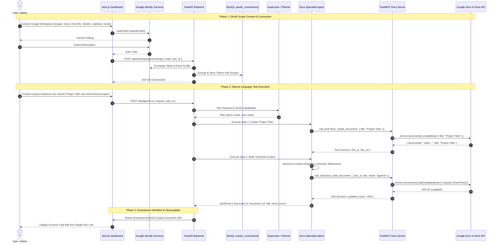

# AxiomFlow Google Docs Integration & Docs Agent Technical Guide

**Version:** 1.0.0  
**Status:** Approved Architectural Specification  
**Target Services:** Google Docs API v1, Google Drive API v3  
**Frameworks:** FastMCP, LangChain, LangGraph, FastAPI, Next.js  

---

## 1. Executive Summary & Integration Purpose

AxiomFlow currently automates enterprise business workflows across Google Workspace using three core services:
- **Gmail:** Email search, thread retrieval, automated drafting, and Human-In-The-Loop (HITL) email dispatching.
- **Google Calendar:** Conflict detection, availability checking, and automated meeting scheduling with Google Meet links.
- **Google Sheets:** Automated spreadsheet generation, business data insertion, tabular analytics, and CSV exports.

This document specifies the technical architecture and step-by-step implementation for adding **Google Docs** as a first-class service integration. Google Docs functions as an enterprise cloud-based document workspace enabling authenticated users and autonomous agents to programmatically create, read, write, append, update, and manage documents on behalf of the user's connected Google account.

In addition to core API tools, this specification introduces the **Docs Agent**—a dedicated LangGraph specialist agent responsible for reasoning about document requirements, interpreting business intent, generating structured business documentation (e.g., executive summaries, meeting minutes, client proposals, policy documents), orchestrating tool execution, and passing document artifacts to downstream agents (such as the Email Content Agent or Summarizer).

---

## 2. System Analysis & Current Architecture Baseline

### 2.1 OAuth 2.0 & Token Architecture
AxiomFlow utilizes the **Google Identity Services (GIS) Authorization Code Flow** with server-side token exchange:
1. **Frontend (Next.js):** The `ConnectView.tsx` component initiates consent via `window.google.accounts.oauth2.initCodeClient` with popup UX (`ux_mode: 'popup'`) and `redirect_uri: 'postmessage'`.
2. **Backend Token Exchange (`/api/oauth/google/exchange`):** FastAPI receives the one-time authorization code and exchanges it directly with Google's Token URI (`https://oauth2.googleapis.com/token`) using confidential client credentials (`GOOGLE_CLIENT_ID` and `GOOGLE_CLIENT_SECRET`).
3. **Token Vault Encryption:** Access and refresh tokens are encrypted at rest using AES-256 via `token_vault.py` and stored in the MySQL `oauth_connections` table.
4. **Automatic Refresh (`google_credentials_manager.py`):** Whenever an agent calls a Google tool, `get_user_google_credentials(user_id, account_email, conn)` inspects token validity, refreshes expired tokens using Google OAuth transport requests, and updates the encrypted credentials in MySQL.
5. **Authorized Service Factory (`tools/client_factory.py`):** Supplies authorized discovery client instances via `get_authorized_service(service_name, version, user_id, account_email)`.

### 2.2 Tooling & Agent Architecture
1. **Tool Layer (FastMCP):** Tools are exposed as typed, deterministic functions under `backend/tools/` using the `FastMCP` framework (e.g., `sheets_mcp`, `calendar_mcp`, `gmail_mcp`).
2. **Central Capability Registry (`backend/agents/tools/registry.py`):** Every capability is registered with risk classifications (`read_only`, `no_external_side_effect`, `external_side_effect`), parameter definitions, and approval flags.
3. **Supervisor / Planner (`backend/agents/supervisior/node.py`):** Translates user natural language instructions into a bounded `StructuredPlan` containing discrete step proposals.
4. **LangGraph State Graph (`backend/agents/graph.py`):** Coordinates multi-agent flows across `WorkflowState`, with conditional routers directing state between specialist execution nodes, HITL approval loops, and summarization.

---

## 3. Official Google Docs API v1 Documentation Analysis

### 3.1 APIs, Libraries, and Endpoints
Google Docs operations are exposed via **Google Docs API v1** and supported by **Google Drive API v3**:

| Service | API Identifier | Discovery Version | Base URL | Primary Role |
| :--- | :--- | :--- | :--- | :--- |
| **Google Docs API** | `docs.googleapis.com` | `v1` | `https://docs.googleapis.com/v1/documents` | Document creation, structural parsing, content insertion, text replacement, and styling |
| **Google Drive API** | `drive.googleapis.com` | `v3` | `https://www.googleapis.com/drive/v3/files` | File metadata, document search, folder management, trashing, and permanent deletion |

#### Python Client Library
The system utilizes the official Google API Python client:
```bash
pip install google-api-python-client google-auth-httplib2 google-auth-oauthlib
```
Initialized in Python via:
```python
from googleapiclient.discovery import build

docs_service = build("docs", "v1", credentials=creds, cache_discovery=False)
drive_service = build("drive", "v3", credentials=creds, cache_discovery=False)
```

---

### 3.2 Scopes & Least-Privilege Permissions Analysis

To maintain security compliance with Google API Services User Data Policies and enterprise least-privilege standards:

| Scope URI | Classification | Operations Permitted | Justification |
| :--- | :--- | :--- | :--- |
| `https://www.googleapis.com/auth/documents` | Sensitive | Read, create, write, append, format, and delete text within Google Docs. | **Required.** Core scope for all Docs API v1 operations. |
| `https://www.googleapis.com/auth/documents.readonly` | Sensitive | Read-only access to Google Docs. | Used if tenant only authorizes read operations. |
| `https://www.googleapis.com/auth/drive.file` | Recommended Least-Privilege | Create new Drive files, access files created/opened by AxiomFlow, move to trash, delete. | **Required for document deletion and trashing.** Avoids requesting unrestricted `drive` scope. |

> [!IMPORTANT]
> **Least-Privilege Mandate:**
> AxiomFlow shall **never** request the broad `https://www.googleapis.com/auth/drive` scope. Instead, pairing `https://www.googleapis.com/auth/documents` with `https://www.googleapis.com/auth/drive.file` grants full document lifecycle management (create, read, update, trash/delete) exclusively for documents managed or created by AxiomFlow without exposing unrelated user files in Google Drive.

---

### 3.3 Core Google Docs API Methods & Request Structures

#### 1. Create a New Blank Document (`documents.create`)
- **Method:** `service.documents().create(body=body).execute()`
- **Official Behavior:** `documents.create` accepts a `title` string in the request body. Note that initial body text cannot be supplied inside `documents.create`; content must be added in a subsequent `batchUpdate` call.
- **Request Payload:**
  ```python
  body = {"title": "Q3 Executive Performance Report"}
  doc = service.documents().create(body=body).execute()
  doc_id = doc.get("documentId")
  doc_url = f"https://docs.google.com/document/d/{doc_id}/edit"
  ```

#### 2. Read Document Content (`documents.get`)
- **Method:** `service.documents().get(documentId=document_id).execute()`
- **Document Structure Hierarchy:**
  Google Docs organizes content as hierarchical structural elements:
  ```
  Document
  ├── documentId: string
  ├── title: string
  ├── body
  │   └── content: List[StructuralElement]
  │       ├── paragraph
  │       │   ├── elements: List[ParagraphElement]
  │       │   │   └── textRun: { content: string, textStyle: {...} }
  │       │   └── paragraphStyle: { namedStyleType: "NORMAL_TEXT" | "HEADING_1" ... }
  │       ├── table
  │       │   └── tableRows: List[TableRow]
  │       └── sectionBreak
  └── revisionId: string
  ```
- **Text Extraction Logic:**
  Plain text is extracted by traversing `body.content`, iterating through paragraph elements, and concatenating `textRun.content`.

#### 3. Write / Append to Document (`documents.batchUpdate`)
All document mutations in Google Docs API occur atomically inside `batchUpdate`:
- **Method:** `service.documents().batchUpdate(documentId=document_id, body={"requests": requests}).execute()`

##### A. Appending Text (`endOfSegmentLocation`)
The most robust approach to appending content without calculating character offsets:
```python
requests = [
    {
        "insertText": {
            "text": "\n## Summary Findings\nAll quarterly targets were exceeded by 14%.\n",
            "endOfSegmentLocation": {
                "segmentId": ""  # Empty string represents the main document body
            }
        }
    }
]
```

##### B. Inserting Text at a Specific Index (`location.index`)
```python
requests = [
    {
        "insertText": {
            "location": {"index": 1},  # Index 1 is the start of the document body
            "text": "CONFIDENTIAL DRAFT - FOR INTERNAL REVIEW ONLY\n\n"
        }
    }
]
```

##### C. Overwriting Document Body
To overwrite an entire document, clear existing content using `deleteContentRange` before inserting new text. Note that the final newline character in a Google Doc cannot be deleted:
```python
# 1. Fetch document to determine end index
doc = service.documents().get(documentId=document_id).execute()
content = doc.get("body", {}).get("content", [])
last_element = content[-1] if content else None
end_index = last_element.get("endIndex", 1) if last_element else 1

requests = []
# Delete content if doc has existing text (preserving index 1 to end_index - 1)
if end_index > 2:
    requests.append({
        "deleteContentRange": {
            "range": {
                "startIndex": 1,
                "endIndex": end_index - 1
            }
        }
    })

requests.append({
    "insertText": {
        "location": {"index": 1},
        "text": new_text
    }
})
```

##### D. Search & Replace Placeholders (`replaceAllText`)
Replaces template tokens (e.g., `{{client_name}}`, `{{meeting_date}}`):
```python
requests = [
    {
        "replaceAllText": {
            "containsText": {
                "text": "{{client_name}}",
                "matchCase": True
            },
            "replaceText": "Acme Innovations Corp"
        }
    }
]
```

##### E. Formatting Text and Headings (`updateParagraphStyle` & `updateTextStyle`)
```python
requests = [
    # Apply Heading 1 styling
    {
        "updateParagraphStyle": {
            "range": {"startIndex": 1, "endIndex": 25},
            "paragraphStyle": {"namedStyleType": "HEADING_1"},
            "fields": "namedStyleType"
        }
    },
    # Apply Bold styling to a specific phrase
    {
        "updateTextStyle": {
            "range": {"startIndex": 1, "endIndex": 25},
            "textStyle": {"bold": True},
            "fields": "bold"
        }
    }
]
```

#### 4. Delete / Trash Document File (`drive.files`)
Google Docs API does not include a file deletion endpoint. File-level deletion is performed via Google Drive API v3:
- **Soft Delete (Move to Trash - Recommended):**
  ```python
  drive_service.files().update(fileId=document_id, body={"trashed": True}).execute()
  ```
- **Permanent Delete:**
  ```python
  drive_service.files().delete(fileId=document_id).execute()
  ```

---

## 4. End-to-End System Sequence Diagram



---

## 5. Architectural Implementation Blueprint

### 5.1 Step 1: Update Frontend OAuth Scopes
File: `frontend/src/components/dashboard/ConnectView.tsx`

Add `https://www.googleapis.com/auth/documents` and `https://www.googleapis.com/auth/drive.file` to the GIS Code Client scopes:

```typescript
// frontend/src/components/dashboard/ConnectView.tsx
const client = window.google.accounts.oauth2.initCodeClient({
  client_id: GOOGLE_CLIENT_ID,
  scope: [
    "openid",
    "https://www.googleapis.com/auth/userinfo.email",
    "https://www.googleapis.com/auth/gmail.send",
    "https://www.googleapis.com/auth/calendar.events",
    "https://www.googleapis.com/auth/spreadsheets",
    "https://www.googleapis.com/auth/documents",
    "https://www.googleapis.com/auth/drive.file",
  ].join(" "),
  ux_mode: "popup",
  callback: async (response: any) => { ... }
});
```

Update the scope indicator badge in `ConnectView.tsx`:
```tsx
<div className="text-xs text-neutral-400">
  Active Scopes: Gmail (Send), Calendar (Events), Sheets (Read/Write), Docs (Read/Write/Create), Drive (File Management)
</div>
```

---

### 5.2 Step 2: Client Factory Support
File: `backend/tools/client_factory.py`

`get_authorized_service` already supports dynamic service loading via `googleapiclient.discovery.build`. Google Docs and Google Drive clients are created directly:

```python
# Create Google Docs API client
docs_service = get_authorized_service(
    service_name="docs",
    version="v1",
    user_id=user_id,
    account_email=account_email
)

# Create Google Drive API client
drive_service = get_authorized_service(
    service_name="drive",
    version="v3",
    user_id=user_id,
    account_email=account_email
)
```

---

### 5.3 Step 3: FastMCP Tool Server Implementation
File: `backend/tools/docs_tools.py`

This module defines deterministic FastMCP tools for Google Docs and Drive:

```python
"""
Google Docs and Google Drive FastMCP Tool Suite for AxiomFlow.
Provides deterministic, production-grade tools for document lifecycle:
- docs_create_document
- docs_read_document
- docs_write_document (append, insert, overwrite)
- docs_replace_text
- docs_delete_content_range
- docs_delete_document
"""
import os
import sys
from typing import Optional, Dict, Any, List
from fastmcp import FastMCP

backend_path = os.path.abspath(os.path.join(os.path.dirname(__file__), ".."))
if backend_path not in sys.path:
    sys.path.insert(0, backend_path)

from tools.client_factory import get_authorized_service

docs_mcp = FastMCP("DocsToolsServer")


@docs_mcp.tool()
def docs_create_document(
    user_id: str,
    account_email: str,
    title: str,
    initial_text: Optional[str] = None
) -> Dict[str, Any]:
    """
    Creates a new Google Document.
    Official Reference: https://developers.google.com/docs/api/reference/rest/v1/documents/create
    """
    service = get_authorized_service(
        service_name="docs",
        version="v1",
        user_id=user_id,
        account_email=account_email
    )

    doc = service.documents().create(body={"title": title}).execute()
    document_id = doc.get("documentId")
    document_url = f"https://docs.google.com/document/d/{document_id}/edit"

    if initial_text:
        requests = [{
            "insertText": {
                "location": {"index": 1},
                "text": initial_text
            }
        }]
        service.documents().batchUpdate(
            documentId=document_id,
            body={"requests": requests}
        ).execute()

    return {
        "status": "success",
        "operation": "docs.create",
        "document_id": document_id,
        "document_url": document_url,
        "title": title
    }


@docs_mcp.tool()
def docs_read_document(
    user_id: str,
    account_email: str,
    document_id: str
) -> Dict[str, Any]:
    """
    Reads a Google Document and extracts plain text, metadata, and structural statistics.
    Official Reference: https://developers.google.com/docs/api/reference/rest/v1/documents/get
    """
    service = get_authorized_service(
        service_name="docs",
        version="v1",
        user_id=user_id,
        account_email=account_email
    )

    doc = service.documents().get(documentId=document_id).execute()
    title = doc.get("title", "Untitled Document")
    body = doc.get("body", {})
    content_elements = body.get("content", [])

    extracted_text = []
    paragraph_count = 0

    for element in content_elements:
        if "paragraph" in element:
            paragraph_count += 1
            for pe in element["paragraph"].get("elements", []):
                if "textRun" in pe:
                    extracted_text.append(pe["textRun"].get("content", ""))

    full_text = "".join(extracted_text)
    word_count = len(full_text.split())

    return {
        "status": "success",
        "operation": "docs.read",
        "document_id": document_id,
        "title": title,
        "document_url": f"https://docs.google.com/document/d/{document_id}/edit",
        "content": full_text,
        "word_count": word_count,
        "paragraph_count": paragraph_count,
        "revision_id": doc.get("revisionId")
    }


@docs_mcp.tool()
def docs_write_document(
    user_id: str,
    account_email: str,
    document_id: str,
    text: str,
    mode: str = "append",
    insert_index: Optional[int] = 1
) -> Dict[str, Any]:
    """
    Writes or updates text in a specified Google Document.
    Supported modes:
    - 'append': Appends text to the end of the document body via endOfSegmentLocation.
    - 'insert': Inserts text at specified character index.
    - 'overwrite': Clears existing body content and inserts new text at index 1.
    """
    service = get_authorized_service(
        service_name="docs",
        version="v1",
        user_id=user_id,
        account_email=account_email
    )

    requests: List[Dict[str, Any]] = []

    if mode == "append":
        requests.append({
            "insertText": {
                "text": text,
                "endOfSegmentLocation": {"segmentId": ""}
            }
        })
    elif mode == "insert":
        idx = max(1, insert_index or 1)
        requests.append({
            "insertText": {
                "location": {"index": idx},
                "text": text
            }
        })
    elif mode == "overwrite":
        doc = service.documents().get(documentId=document_id).execute()
        content = doc.get("body", {}).get("content", [])
        end_idx = content[-1].get("endIndex", 1) if content else 1
        if end_idx > 2:
            requests.append({
                "deleteContentRange": {
                    "range": {
                        "startIndex": 1,
                        "endIndex": end_idx - 1
                    }
                }
            })
        requests.append({
            "insertText": {
                "location": {"index": 1},
                "text": text
            }
        })
    else:
        raise ValueError(f"Unsupported write mode '{mode}'. Choose 'append', 'insert', or 'overwrite'.")

    result = service.documents().batchUpdate(
        documentId=document_id,
        body={"requests": requests}
    ).execute()

    return {
        "status": "success",
        "operation": f"docs.write_{mode}",
        "document_id": document_id,
        "document_url": f"https://docs.google.com/document/d/{document_id}/edit",
        "replies_count": len(result.get("replies", [])),
        "characters_written": len(text)
    }


@docs_mcp.tool()
def docs_replace_text(
    user_id: str,
    account_email: str,
    document_id: str,
    search_text: str,
    replace_text: str,
    match_case: bool = True
) -> Dict[str, Any]:
    """
    Replaces all occurrences of search_text with replace_text using replaceAllText.
    Ideal for template placeholder substitution.
    """
    service = get_authorized_service(
        service_name="docs",
        version="v1",
        user_id=user_id,
        account_email=account_email
    )

    requests = [{
        "replaceAllText": {
            "containsText": {
                "text": search_text,
                "matchCase": match_case
            },
            "replaceText": replace_text
        }
    }]

    result = service.documents().batchUpdate(
        documentId=document_id,
        body={"requests": requests}
    ).execute()

    occurrences = 0
    for reply in result.get("replies", []):
        if "replaceAllText" in reply:
            occurrences += reply["replaceAllText"].get("occurrencesChanged", 0)

    return {
        "status": "success",
        "operation": "docs.replace_text",
        "document_id": document_id,
        "occurrences_changed": occurrences
    }


@docs_mcp.tool()
def docs_delete_content_range(
    user_id: str,
    account_email: str,
    document_id: str,
    start_index: int,
    end_index: int
) -> Dict[str, Any]:
    """
    Deletes content within a specified index range in a Google Document.
    """
    if start_index < 1 or end_index <= start_index:
        raise ValueError("Invalid index range: start_index must be >= 1 and < end_index.")

    service = get_authorized_service(
        service_name="docs",
        version="v1",
        user_id=user_id,
        account_email=account_email
    )

    requests = [{
        "deleteContentRange": {
            "range": {
                "startIndex": start_index,
                "endIndex": end_index
            }
        }
    }]

    service.documents().batchUpdate(
        documentId=document_id,
        body={"requests": requests}
    ).execute()

    return {
        "status": "success",
        "operation": "docs.delete_range",
        "document_id": document_id,
        "deleted_range": {"start": start_index, "end": end_index}
    }


@docs_mcp.tool()
def docs_delete_document(
    user_id: str,
    account_email: str,
    document_id: str,
    permanent: bool = False
) -> Dict[str, Any]:
    """
    Deletes or trashes a Google Document file via Google Drive API v3.
    Requires scope https://www.googleapis.com/auth/drive.file.
    """
    drive_service = get_authorized_service(
        service_name="drive",
        version="v3",
        user_id=user_id,
        account_email=account_email
    )

    if permanent:
        drive_service.files().delete(fileId=document_id).execute()
        action = "permanently_deleted"
    else:
        drive_service.files().update(fileId=document_id, body={"trashed": True}).execute()
        action = "moved_to_trash"

    return {
        "status": "success",
        "operation": "docs.delete_document",
        "document_id": document_id,
        "action": action
    }
```

---

### 5.4 Step 4: Capability Registry Updates
File: `backend/agents/tools/registry.py`

Register the approved Docs capabilities with security attributes:

```python
# Add to CAPABILITY_REGISTRY in backend/agents/tools/registry.py:
"docs.create": {
    "description": "Creates a new blank Google Document with a title and optional initial text",
    "service": "docs",
    "risk": "external_side_effect",
    "requires_approval": True,
    "parameters": ["title", "initial_text"]
},
"docs.read": {
    "description": "Reads full content, structural elements, and word count from a specified Google Document",
    "service": "docs",
    "risk": "read_only",
    "requires_approval": False,
    "parameters": ["document_id"]
},
"docs.write": {
    "description": "Appends, inserts, or overwrites content in a specified Google Document",
    "service": "docs",
    "risk": "external_side_effect",
    "requires_approval": True,
    "parameters": ["document_id", "text", "mode"]
},
"docs.replace_text": {
    "description": "Replaces placeholders or occurrences of text in a Google Document",
    "service": "docs",
    "risk": "external_side_effect",
    "requires_approval": True,
    "parameters": ["document_id", "search_text", "replace_text"]
},
"docs.delete": {
    "description": "Deletes or moves a Google Document to trash via Google Drive API",
    "service": "docs",
    "risk": "external_side_effect",
    "requires_approval": True,
    "parameters": ["document_id", "permanent"]
}
```

---

### 5.5 Step 5: Shared State Schema (`state.py`)
File: `backend/agents/state.py`

Define `DocResult` and expand `WorkflowState`:

```python
class DocResult(BaseModel):
    """Outcome payload from Docs Agent / FastMCP docs execution."""
    document_id: str = Field(..., description="Google Document ID")
    document_url: str = Field(..., description="Web URL to open and edit document in browser")
    title: str = Field(..., description="Document Title")
    operation: str = Field(..., description="Primary operation performed (e.g. 'created', 'updated', 'read')")
    content_preview: Optional[str] = Field(default=None, description="Preview of document content")
    word_count: Optional[int] = Field(default=0, description="Estimated total word count")
    status: Literal["success", "failed"] = Field(default="success")

# Inside WorkflowState TypedDict:
class WorkflowState(TypedDict, total=False):
    ...
    docs_result: Optional[Dict[str, Any]]  # Stores DocResult dict
    ...
    status: Literal[
        "initializing",
        "assessing",
        "awaiting_clarification",
        "planning",
        "executing_calendar",
        "executing_sheet",
        "executing_docs",
        "drafting_email",
        "awaiting_email_consent",
        "executing_gmail",
        "succeeded",
        "failed",
        "rejected"
    ]
```

---

### 5.6 Step 6: Docs Agent Implementation (`docs_agent.py`)
File: `backend/agents/specialists/docs_agent.py`

The **Docs Agent** acts as the domain specialist for Google Docs. It leverages LLM structured reasoning to compose well-structured documents and calls FastMCP tools:

```python
"""
Docs Specialist Agent for AxiomFlow.
Responsible for:
- Interpreting document generation, reading, appending, and updating intent
- Structuring professional document sections (Executive Summary, Findings, Action Items)
- Executing FastMCP Google Docs tools (docs_create_document, docs_read_document, docs_write_document)
- Emitting real-time observability logs to terminal and returning DocResult
"""
import os
import sys
from typing import Dict, Any, Optional
from pydantic import BaseModel, Field
from langchain_core.messages import SystemMessage, HumanMessage

backend_path = os.path.abspath(os.path.join(os.path.dirname(__file__), "..", ".."))
if backend_path not in sys.path:
    sys.path.insert(0, backend_path)

from agents.config import settings
from agents.model_factory import get_resilient_chat_model
from agents.state import DocResult, WorkflowState
from tools.docs_tools import docs_mcp

DOCS_AGENT_SYSTEM_PROMPT = """You are the Google Docs Specialist Agent for AxiomFlow.
Your objective is to generate clear, structured, and executive business document content.
When composing documents:
1. Provide a professional title.
2. Structure sections logically (e.g. Overview, Key Objectives, Analysis, Recommendations).
3. Use clean paragraph separation with newlines.
"""

class ComposedDocument(BaseModel):
    title: str = Field(..., description="Concise title for the document")
    formatted_body: str = Field(..., description="Complete structured document text with headings and paragraphs")


class DocsAgent:
    """
    Specialist Agent responsible for managing Google Docs operations.
    """

    def __init__(self, temperature: float = 0.2):
        self.temperature = temperature
        self.resilient_model = get_resilient_chat_model(temperature=self.temperature)

    def compose_document_content(
        self,
        request: str,
        business_context: Dict[str, Any],
        supporting_data: Optional[str] = None
    ) -> ComposedDocument:
        """Composes structured document text using LLM structured output."""
        structured_llm = self.resilient_model.with_structured_output(ComposedDocument)
        user_prompt = f"""Business Request: {request}
Company Name: {business_context.get('business_name', 'Enterprise')}
Supporting Context/Data: {supporting_data or 'None provided'}

Compose a complete, publication-ready document body."""

        messages = [
            SystemMessage(content=DOCS_AGENT_SYSTEM_PROMPT),
            HumanMessage(content=user_prompt)
        ]
        return structured_llm.invoke(messages)

    async def create_and_write_doc_via_mcp(
        self,
        user_id: str,
        account_email: str,
        title: str,
        content: str
    ) -> DocResult:
        """
        Executes Google Doc creation and content writing via FastMCP tools:
        1. docs_create_document
        2. docs_write_document (mode: append)
        """
        print("\n" + "=" * 80)
        print("          [DOCS AGENT] INITIALIZING GOOGLE DOC CREATION & WRITING")
        print("=" * 80)
        print(f"User ID:        {user_id}")
        print(f"Account Email:  {account_email}")
        print(f"Document Title: {title}")
        print(f"Content Length: {len(content)} characters")
        print("-" * 80)

        # Step 1: Create Document
        create_args = {
            "user_id": user_id,
            "account_email": account_email,
            "title": title
        }
        create_res = await docs_mcp.call_tool("docs_create_document", create_args)
        if create_res.is_error:
            raise RuntimeError(f"FastMCP docs_create_document failed: {create_res.content}")

        raw_create = create_res.structured_content or {}
        create_data = raw_create.get("result", raw_create)
        doc_id = create_data.get("document_id")
        doc_url = create_data.get("document_url")

        print(f"[DOCS AGENT] Step 1: Document Created! ID: {doc_id}")
        print(f"  URL: {doc_url}")

        # Step 2: Write Content
        print(f"[DOCS AGENT] Step 2: Appending content into '{title}'...")
        write_args = {
            "user_id": user_id,
            "account_email": account_email,
            "document_id": doc_id,
            "text": content,
            "mode": "append"
        }
        write_res = await docs_mcp.call_tool("docs_write_document", write_args)
        if write_res.is_error:
            raise RuntimeError(f"FastMCP docs_write_document failed: {write_res.content}")

        word_count = len(content.split())
        preview = content[:200] + "..." if len(content) > 200 else content

        print(f"[DOCS AGENT] Step 3: Successfully written {word_count} words.")
        print("=" * 80 + "\n")

        return DocResult(
            document_id=doc_id,
            document_url=doc_url,
            title=title,
            operation="created_and_written",
            content_preview=preview,
            word_count=word_count,
            status="success"
        )
```

---

### 5.7 Step 7: LangGraph Node & Router Integration
Files: `backend/agents/nodes/execute.py` and `backend/agents/graph.py`

#### 1. Execution Node (`backend/agents/nodes/execute.py`):
```python
from agents.specialists.docs_agent import DocsAgent

async def execute_docs_node(state: WorkflowState) -> Dict[str, Any]:
    """
    LangGraph node: Executes Google Docs creation, reading, or writing via DocsAgent and FastMCP.
    """
    user_id = state.get("user_id", "")
    account_email = state.get("account_email", "")
    request = state.get("request", "")
    business_context = state.get("business_context", {})
    plan = state.get("plan", {})

    agent = DocsAgent()

    # Check if plan specified parameters
    doc_title = "AxiomFlow Automated Document"
    for step in plan.get("steps", []):
        if "docs" in step.get("capability", ""):
            params = step.get("parameters", {})
            if "title" in params:
                doc_title = params["title"]
                break

    # Compose content
    composed = agent.compose_document_content(request, business_context)
    title_to_use = doc_title if doc_title != "AxiomFlow Automated Document" else composed.title

    doc_result = await agent.create_and_write_doc_via_mcp(
        user_id=user_id,
        account_email=account_email,
        title=title_to_use,
        content=composed.formatted_body
    )

    outcomes = list(state.get("tool_outcomes", []))
    outcomes.append({
        "step_id": "docs_create_and_write",
        "capability": "docs.write",
        "status": "succeeded",
        "resource_id": doc_result.document_id,
        "data": doc_result.model_dump()
    })

    return {
        "docs_result": doc_result.model_dump(),
        "tool_outcomes": outcomes,
        "status": "executing_docs"
    }
```

#### 2. Graph Wiring & Multi-Service Routing (`backend/agents/graph.py`):
Update conditional routers to allow smooth composition between **Sheets**, **Docs**, **Calendar**, and **Gmail**:

```python
def route_after_plan(state: WorkflowState) -> Literal["execute_sheet", "execute_docs", "execute_calendar", "draft_email", "summarize"]:
    plan = state.get("plan") or {}
    steps = plan.get("steps", [])
    has_sheets = any("sheets" in s.get("capability", "") for s in steps)
    has_docs = any("docs" in s.get("capability", "") for s in steps)
    has_calendar = any("calendar" in s.get("capability", "") for s in steps)
    has_email = any("gmail" in s.get("capability", "") or "email" in s.get("capability", "") or "content" in s.get("capability", "") for s in steps)

    if has_sheets:
        return "execute_sheet"
    elif has_docs:
        return "execute_docs"
    elif has_calendar:
        return "execute_calendar"
    elif has_email:
        return "draft_email"
    return "summarize"


def route_after_docs(state: WorkflowState) -> Literal["execute_calendar", "draft_email", "summarize"]:
    plan = state.get("plan") or {}
    steps = plan.get("steps", [])
    has_calendar = any("calendar" in s.get("capability", "") for s in steps)
    calendar_event = state.get("calendar_event")
    if has_calendar and not calendar_event:
        return "execute_calendar"
    has_email = any("gmail" in s.get("capability", "") or "email" in s.get("capability", "") or "content" in s.get("capability", "") for s in steps)
    if has_email:
        return "draft_email"
    return "summarize"
```

---

## 6. Security, Policy & Safety Rules

1. **OAuth Least Privilege:** Only request `https://www.googleapis.com/auth/documents` and `https://www.googleapis.com/auth/drive.file`. Never request full Drive access.
2. **Encrypted Token Handling:** Access tokens and refresh tokens must never appear in raw text logs, frontend payloads, or prompt contexts.
3. **Destructive Operation Safeguards:** 
   - `docs_delete_document` permanently or moves files to trash. It requires `requires_approval: True` in the capability registry.
   - `docs_write_document` with mode `overwrite` clears existing body text and requires user confirmation or explicit parameter consent.
4. **Tenant Isolation:** Every Docs tool call enforces tenant scoping via `user_id` and verified `account_email` fetched from authenticated database sessions.

---

## 7. Verification & Testing Matrix

| Test Case | Objective | Method / Tool | Expected Result |
| :--- | :--- | :--- | :--- |
| **TC-DOCS-01** | Create a blank document | `docs_create_document` | Returns valid `document_id`, HTTP 200, URL matches `https://docs.google.com/document/d/{id}/edit`. |
| **TC-DOCS-02** | Append formatted content | `docs_write_document(mode='append')` | Content is appended to document body using `endOfSegmentLocation` without index error. |
| **TC-DOCS-03** | Read document body | `docs_read_document` | Extracted string matches inserted text; word count and paragraph count accurately calculated. |
| **TC-DOCS-04** | Template placeholder replacement | `docs_replace_text` | All occurrences of `{{token}}` are replaced with target text; `occurrences_changed` > 0. |
| **TC-DOCS-05** | Overwrite document | `docs_write_document(mode='overwrite')` | Previous text cleared from index 1 to end-1; new text correctly positioned at index 1. |
| **TC-DOCS-06** | Trash document | `docs_delete_document(permanent=False)` | Drive API sets `trashed=True`; file is present in Google Drive trash bin. |
| **TC-DOCS-07** | End-to-End Multi-Service | Natural Language Prompt | LangGraph routes: Plan -> DocsAgent -> ContentAgent (attaching doc link) -> Email Consent HITL -> Gmail Send. |

---

## 8. Summary of Files Changed & Created

| File Path | Action | Description |
| :--- | :--- | :--- |
| `frontend/src/components/dashboard/ConnectView.tsx` | Modify | Adds Google Docs & Drive.file OAuth scopes and updates UI status. |
| `backend/tools/docs_tools.py` | Create | FastMCP tool server providing create, read, write, append, replace, and delete tools. |
| `backend/agents/tools/docs_tools.py` | Create | Exposes FastMCP docs tools to agent modules. |
| `backend/agents/tools/registry.py` | Modify | Registers `docs.create`, `docs.read`, `docs.write`, `docs.replace_text`, `docs.delete`. |
| `backend/agents/state.py` | Modify | Defines `DocResult` schema and adds `docs_result` to `WorkflowState`. |
| `backend/agents/specialists/docs_agent.py` | Create | Implements `DocsAgent` for structured content composition and tool execution. |
| `backend/agents/nodes/execute.py` | Modify | Implements `execute_docs_node` for LangGraph orchestration. |
| `backend/agents/graph.py` | Modify | Adds `execute_docs` node and multi-service routing edges. |
| `backend/agents/supervisior/prompts.py` | Modify | Updates supervisor system prompt and sufficiency rules for Docs operations. |
