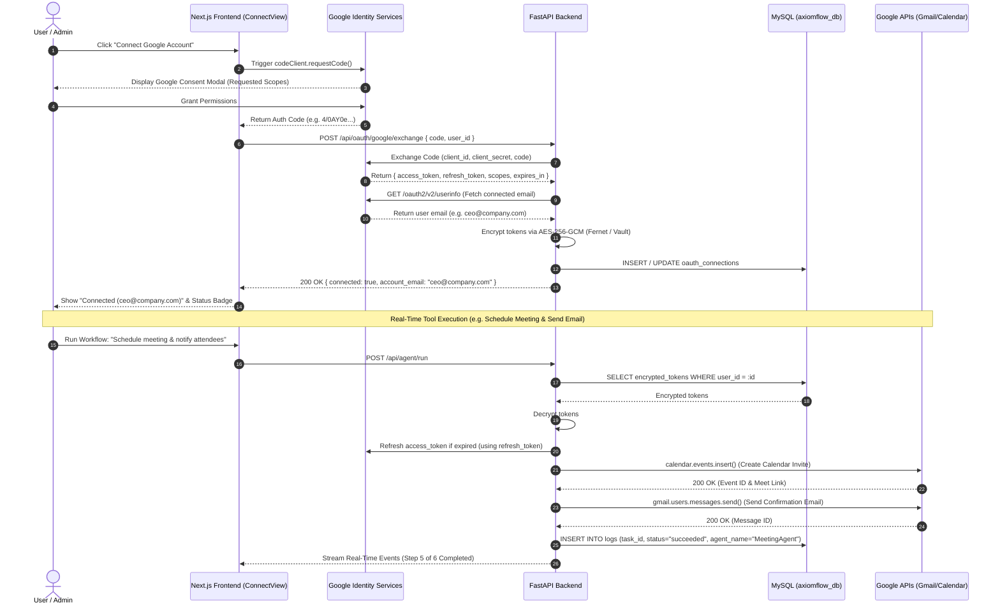

# AxiomFlow Google OAuth 2.0 Integration & Tool Execution Technical Guide

This guide provides the complete, production-grade architecture and implementation plan for integrating Google APIs (Gmail, Google Calendar, Google Sheets) into the AxiomFlow local web application using **Google OAuth 2.0**.

It strictly adheres to Google's Developer Identity policies, the Google API Services User Data Policy, token encryption mandates, and modern security best practices.

---

## 1. Architectural Strategy: Code Model vs. Deprecated Implicit Flow

### Why the JavaScript Implicit Flow is Prohibited
Historically, client-side web applications used the OAuth 2.0 Implicit Flow (`response_type=token`), which returned access tokens directly in the URL hash fragment. **Google has officially deprecated the Implicit Flow** for the following critical reasons:
1. **Security Vulnerability**: Access tokens in the browser URL hash can leak via browser history, `Referer` headers, and browser extensions, creating severe XSS/token theft vulnerabilities.
2. **No Offline Access / Refresh Tokens**: Implicit flow only grants short-lived access tokens (typically 1 hour). AxiomFlow agent workflows require executing tasks asynchronously and in real time (e.g., sending follow-up emails, syncing calendar events hours later) without continuously interrupting the user to re-authenticate.
3. **Google Policy Non-Compliance**: Google's updated Identity Services mandate the **Authorization Code Model** for any application requiring server-side or long-lived API operations.

### Mandated Architecture: Google Identity Services (GIS) Code Model
AxiomFlow implements the **Google Identity Services Authorization Code Flow with Server-Side Exchange**:
- **Frontend (Next.js)** initializes the Google Identity Services Code Client (`google.accounts.oauth2.initCodeClient`).
- The user completes the Google Consent Screen in a secure popup.
- Google returns a **one-time Authorization Code** to the frontend callback.
- The frontend forwards this authorization code over an authenticated internal API call to the **FastAPI Backend**.
- The FastAPI backend exchanges the authorization code directly with Google's token endpoint (`https://oauth2.googleapis.com/token`) using its confidential `client_secret`.
- The backend receives both an `access_token` and an offline `refresh_token`.
- The backend encrypts these tokens using **AES-256-GCM** and stores them in the database (`oauth_connections`).
- Frontend never receives the `refresh_token` or `client_secret`, preventing credential exposure.

---

## 2. End-to-End System Flow Diagram



---

## 3. Google Cloud Console Setup & Localhost Configuration

To run and test Google OAuth 2.0 locally on `http://localhost:3000` and `http://localhost:8000`:

### Step 3.1: Create Project & Enable APIs
1. Navigate to [Google Cloud Console](https://console.cloud.google.com/).
2. Create a new project: **`AxiomFlow Automation`**.
3. Go to **APIs & Services > Library** and enable:
   - **Gmail API** (`gmail.googleapis.com`)
   - **Google Calendar API** (`calendar-json.googleapis.com`)
   - **Google Sheets API** (`sheets.googleapis.com`)
   - **Google Drive API** (`drive.googleapis.com` - optional, if reading files)

### Step 3.2: Configure OAuth Consent Screen
1. Go to **APIs & Services > OAuth consent screen**.
2. **User Type**:
   - Choose **Internal** if using a Google Workspace domain (all users within the company organization can access without Google verification).
   - Choose **External** if using standard `@gmail.com` accounts. Set **Publishing status** to **Testing**.
3. **App Information**:
   - App name: `AxiomFlow Automation Engine`
   - User support email: `your-email@company.com`
   - Developer contact email: `your-email@company.com`
4. **Scopes (Incremental Least-Privilege)**:
   Add the following specific scopes:
   - `openid`
   - `https://www.googleapis.com/auth/userinfo.email`
   - `https://www.googleapis.com/auth/gmail.send` *(Only send mail, do NOT request full mailbox read/delete)*
   - `https://www.googleapis.com/auth/calendar.events` *(Only read/write events, do NOT request full secondary calendar admin)*
   - `https://www.googleapis.com/auth/spreadsheets` *(Read/append row data)*
5. **Test Users (Crucial for Localhost)**:
   - Under **Test users**, add all developer and company Google accounts that will be tested during local development (e.g. `test.admin@yourdomain.com`).
   - *Note: External test apps can only authenticate emails listed explicitly in the Test Users list.*

### Step 3.3: Create OAuth 2.0 Client Credentials
1. Go to **APIs & Services > Credentials > Create Credentials > OAuth client ID**.
2. **Application type**: **Web application**.
3. **Name**: `AxiomFlow Web Client (Local)`.
4. **Authorized JavaScript origins**:
   - `http://localhost:3000`
   - `http://127.0.0.1:3000`
5. **Authorized redirect URIs**:
   - `http://localhost:3000`
   - `http://localhost:8000/api/oauth/google/callback`
   - `postmessage` *(Special redirect URI used by Google Identity Services popup code client)*
6. Click **Create** and securely copy:
   - `Client ID` (e.g., `1234567890-abc123xyz.apps.googleusercontent.com`)
   - `Client Secret` (e.g., `GOCSPX-xxxxxxxxxxxxxxxxxxxx`)

---

## 4. Google Policies & Security Compliance

Google enforces strict rules under the **Google API Services User Data Policy**. AxiomFlow ensures 100% compliance via:

| Policy Requirement | Google Mandate | AxiomFlow Implementation |
| :--- | :--- | :--- |
| **Minimum Viable Scopes** | Only request scopes strictly needed to execute the user-requested feature. | Do not use `https://mail.google.com/` (full access). Instead, use `gmail.send` for email notifications, and `calendar.events` for event creation. |
| **Incremental Consent** | Request permissions contextually when the user activates a connector. | Connect Google Account inside the dashboard `ConnectView` when the user enables email/calendar tools, not during initial app signup. |
| **Data Encryption at Rest** | Refresh tokens and access tokens must never be stored in plaintext. | All tokens are encrypted using **AES-256-GCM** via the `cryptography.fernet` engine before writing to MySQL. |
| **No Client Leakage** | `client_secret` and `refresh_token` must never be sent to the client browser. | Kept strictly on the FastAPI server; frontend only receives authentication status and connected email. |
| **Revocation & Deletion** | Users must be able to disconnect and revoke access at any time. | Providing a "Revoke Access" button in `ConnectView` which calls Google's revocation endpoint (`https://oauth2.googleapis.com/revoke`) and purges tokens from MySQL. |
| **AI Data Privacy** | Sensitive user data from Google APIs cannot be used to train generalized LLMs without explicit consent. | All user data retrieved via Google APIs is passed strictly in-memory to prompt execution for deterministic tasks and is discarded. |

---

## 5. Database Schema: `oauth_connections`

Add the following table to `backend/create_tables.py` and `docs/db_schema.md`:

```sql
CREATE TABLE IF NOT EXISTS `oauth_connections` (
    `id` INT AUTO_INCREMENT PRIMARY KEY,
    `user_id` VARCHAR(64) NOT NULL,
    `business_id` INT NOT NULL,
    `provider` VARCHAR(50) NOT NULL DEFAULT 'google',
    `account_email` VARCHAR(255) NOT NULL,
    `encrypted_access_token` TEXT NOT NULL,
    `encrypted_refresh_token` TEXT NULL,
    `token_expiry` TIMESTAMP NULL,
    `scopes` TEXT NOT NULL,
    `status` ENUM('active', 'revoked', 'expired') DEFAULT 'active',
    `created_at` TIMESTAMP DEFAULT CURRENT_TIMESTAMP,
    `updated_at` TIMESTAMP DEFAULT CURRENT_TIMESTAMP ON UPDATE CURRENT_TIMESTAMP,
    UNIQUE KEY `uq_user_provider_email` (`user_id`, `provider`, `account_email`),
    INDEX `idx_oauth_user_id` (`user_id`),
    INDEX `idx_oauth_business_id` (`business_id`),
    CONSTRAINT `fk_oauth_user` FOREIGN KEY (`user_id`) REFERENCES `users` (`user_id`) ON DELETE CASCADE,
    CONSTRAINT `fk_oauth_business` FOREIGN KEY (`business_id`) REFERENCES `business_profile` (`id`) ON DELETE CASCADE
) ENGINE=InnoDB DEFAULT CHARSET=utf8mb4 COLLATE=utf8mb4_unicode_ci;
```

---

## 6. Backend Implementation (FastAPI & Python)

### 6.1 Install Required Python Dependencies
Add to `requirements.txt`:
```txt
google-auth>=2.29.0
google-auth-oauthlib>=1.2.0
google-api-python-client>=2.125.0
cryptography>=42.0.5
requests>=2.31.0
```

### 6.2 Token Encryption Vault (`backend/token_vault.py`)
This utility handles authenticated AES-256 encryption and decryption for sensitive tokens:

```python
import os
from cryptography.fernet import Fernet
from dotenv import load_dotenv

load_dotenv()

# Master encryption key (32 url-safe base64-encoded bytes)
# Generate with: python -c "from cryptography.fernet import Fernet; print(Fernet.generate_key().decode())"
ENCRYPTION_KEY = os.getenv("OAUTH_TOKEN_ENCRYPTION_KEY")

if not ENCRYPTION_KEY:
    raise RuntimeError("CRITICAL: OAUTH_TOKEN_ENCRYPTION_KEY is not set in environment!")

cipher_suite = Fernet(ENCRYPTION_KEY.encode())

def encrypt_token(plain_token: str) -> str:
    """Encrypts plaintext token string into encrypted ciphertext."""
    if not plain_token:
        return ""
    return cipher_suite.encrypt(plain_token.encode('utf-8')).decode('utf-8')

def decrypt_token(encrypted_token: str) -> str:
    """Decrypts ciphertext into original plaintext token string."""
    if not encrypted_token:
        return ""
    return cipher_suite.decrypt(encrypted_token.encode('utf-8')).decode('utf-8')
```

### 6.3 Google OAuth Service & Endpoints (`backend/google_oauth.py`)
Handles code exchange, credential refreshing, and token revocation:

```python
import os
import requests
from datetime import datetime, timezone
from typing import Optional, Dict, Any
from fastapi import APIRouter, HTTPException, Depends
from pydantic import BaseModel
from google.oauth2.credentials import Credentials
from google.auth.transport.requests import Request
import pymysql

from token_vault import encrypt_token, decrypt_token

router = APIRouter(prefix="/api/oauth/google", tags=["Google OAuth"])

GOOGLE_CLIENT_ID = os.getenv("GOOGLE_CLIENT_ID")
GOOGLE_CLIENT_SECRET = os.getenv("GOOGLE_CLIENT_SECRET")
GOOGLE_TOKEN_URI = "https://oauth2.googleapis.com/token"
GOOGLE_REVOKE_URI = "https://oauth2.googleapis.com/revoke"
GOOGLE_USERINFO_URI = "https://www.googleapis.com/oauth2/v2/userinfo"

class ExchangeCodeRequest(BaseModel):
    code: str
    user_id: str
    business_id: int

class RevokeRequest(BaseModel):
    user_id: str
    account_email: str

def get_db():
    # Uses database connection from main.py
    import main
    conn = main.get_db_connection()
    try:
        yield conn
    finally:
        conn.close()

@router.post("/exchange")
def exchange_google_code(req: ExchangeCodeRequest, conn = Depends(get_db)):
    """
    Exchanges one-time authorization code for access and refresh tokens,
    encrypts the tokens, and associates them with the user.
    """
    # 1. Exchange code with Google Token Endpoint
    # When using GIS popup code client, redirect_uri must be 'postmessage'
    token_payload = {
        "code": req.code,
        "client_id": GOOGLE_CLIENT_ID,
        "client_secret": GOOGLE_CLIENT_SECRET,
        "redirect_uri": "postmessage",
        "grant_type": "authorization_code"
    }
    
    resp = requests.post(GOOGLE_TOKEN_URI, data=token_payload)
    if resp.status_code != 200:
        raise HTTPException(status_code=400, detail=f"Google token exchange failed: {resp.text}")
    
    token_data = resp.json()
    access_token = token_data.get("access_token")
    refresh_token = token_data.get("refresh_token")
    expires_in = token_data.get("expires_in", 3600)
    scopes = token_data.get("scope", "")

    # 2. Retrieve user identity (account email)
    userinfo_resp = requests.get(
        GOOGLE_USERINFO_URI,
        headers={"Authorization": f"Bearer {access_token}"}
    )
    if userinfo_resp.status_code != 200:
        raise HTTPException(status_code=400, detail="Failed to fetch user email from Google")
    
    userinfo = userinfo_resp.json()
    account_email = userinfo.get("email")

    # 3. Encrypt tokens at rest
    enc_access = encrypt_token(access_token)
    enc_refresh = encrypt_token(refresh_token) if refresh_token else None

    # Calculate token expiry timestamp
    expiry_time = datetime.now(timezone.utc).timestamp() + expires_in
    expiry_dt = datetime.fromtimestamp(expiry_time, tz=timezone.utc)

    # 4. Save/Update in MySQL
    with conn.cursor() as cursor:
        sql = """
        INSERT INTO oauth_connections 
        (user_id, business_id, provider, account_email, encrypted_access_token, 
         encrypted_refresh_token, token_expiry, scopes, status)
        VALUES (%s, %s, 'google', %s, %s, %s, %s, %s, 'active')
        ON DUPLICATE KEY UPDATE 
            encrypted_access_token = VALUES(encrypted_access_token),
            encrypted_refresh_token = COALESCE(VALUES(encrypted_refresh_token), encrypted_refresh_token),
            token_expiry = VALUES(token_expiry),
            scopes = VALUES(scopes),
            status = 'active',
            updated_at = CURRENT_TIMESTAMP;
        """
        cursor.execute(sql, (
            req.user_id,
            req.business_id,
            account_email,
            enc_access,
            enc_refresh,
            expiry_dt,
            scopes
        ))
        conn.commit()

    return {
        "success": True,
        "message": "Google Account connected successfully",
        "account_email": account_email,
        "scopes": scopes.split(" ")
    }

@router.get("/status/{user_id}")
def get_connected_accounts(user_id: str, conn = Depends(get_db)):
    """Returns list of connected accounts without exposing secret tokens."""
    with conn.cursor() as cursor:
        cursor.execute(
            "SELECT account_email, scopes, status, updated_at "
            "FROM oauth_connections WHERE user_id = %s AND provider = 'google'",
            (user_id,)
        )
        rows = cursor.fetchall()
        return {"connected_accounts": rows}

@router.post("/revoke")
def revoke_google_token(req: RevokeRequest, conn = Depends(get_db)):
    """Revokes token directly with Google and marks connection revoked in DB."""
    with conn.cursor() as cursor:
        cursor.execute(
            "SELECT encrypted_access_token, encrypted_refresh_token "
            "FROM oauth_connections WHERE user_id = %s AND account_email = %s",
            (req.user_id, req.account_email)
        )
        row = cursor.fetchone()
        if not row:
            raise HTTPException(status_code=404, detail="Connection record not found")

        # Decrypt token to revoke
        refresh_token = decrypt_token(row.get("encrypted_refresh_token"))
        token_to_revoke = refresh_token or decrypt_token(row.get("encrypted_access_token"))

        # Send revocation request to Google
        if token_to_revoke:
            requests.post(GOOGLE_REVOKE_URI, params={"token": token_to_revoke})

        # Remove or mark revoked in DB
        cursor.execute(
            "DELETE FROM oauth_connections WHERE user_id = %s AND account_email = %s",
            (req.user_id, req.account_email)
        )
        conn.commit()

    return {"success": True, "message": "Google Account revoked and deleted successfully"}
```

### 6.4 Auto-Refreshing Credentials Helper (`backend/google_credentials_manager.py`)
This module retrieves the user's encrypted tokens from the DB, checks expiry, automatically refreshes with Google if needed, and returns an authenticated `google.oauth2.credentials.Credentials` object for tool execution:

```python
from datetime import datetime, timezone
from google.oauth2.credentials import Credentials
from google.auth.transport.requests import Request
import os
import pymysql
from token_vault import decrypt_token, encrypt_token

GOOGLE_CLIENT_ID = os.getenv("GOOGLE_CLIENT_ID")
GOOGLE_CLIENT_SECRET = os.getenv("GOOGLE_CLIENT_SECRET")
GOOGLE_TOKEN_URI = "https://oauth2.googleapis.com/token"

def get_user_google_credentials(user_id: str, account_email: str, conn) -> Credentials:
    """
    Fetches, decrypts, and automatically refreshes Google credentials for a user.
    Persists updated access tokens back to MySQL if refreshed.
    """
    with conn.cursor() as cursor:
        cursor.execute(
            "SELECT encrypted_access_token, encrypted_refresh_token, scopes, token_expiry "
            "FROM oauth_connections WHERE user_id = %s AND account_email = %s AND status = 'active'",
            (user_id, account_email)
        )
        record = cursor.fetchone()
        if not record:
            raise ValueError(f"No active Google connection found for user {user_id} and email {account_email}")

    access_token = decrypt_token(record["encrypted_access_token"])
    refresh_token = decrypt_token(record["encrypted_refresh_token"])
    scopes = record["scopes"].split(" ") if record["scopes"] else []

    creds = Credentials(
        token=access_token,
        refresh_token=refresh_token,
        token_uri=GOOGLE_TOKEN_URI,
        client_id=GOOGLE_CLIENT_ID,
        client_secret=GOOGLE_CLIENT_SECRET,
        scopes=scopes
    )

    # If the access token has expired or is invalid, refresh it automatically
    if not creds.valid:
        if creds.expired and creds.refresh_token:
            creds.refresh(Request())
            # Save new encrypted access token back to DB
            new_enc_access = encrypt_token(creds.token)
            with conn.cursor() as cursor:
                cursor.execute(
                    "UPDATE oauth_connections SET encrypted_access_token = %s, updated_at = CURRENT_TIMESTAMP "
                    "WHERE user_id = %s AND account_email = %s",
                    (new_enc_access, user_id, account_email)
                )
                conn.commit()
        else:
            raise PermissionError("Google OAuth credentials expired and cannot be refreshed. User must re-connect.")

    return creds
```

---

## 7. Real-Time Tool Execution Modules

### 7.1 Gmail Tool: Send Email (`backend/tools/gmail_tool.py`)

```python
import base64
from email.mime.text import MIMEText
from email.mime.multipart import MIMEMultipart
from googleapiclient.discovery import build
from google_credentials_manager import get_user_google_credentials

def send_company_email(
    user_id: str,
    account_email: str,
    to_email: str,
    subject: str,
    body_text: str,
    body_html: str = None,
    conn = None
) -> dict:
    """
    Sends an email using the user's connected Google account via Gmail API.
    """
    creds = get_user_google_credentials(user_id, account_email, conn)
    service = build("gmail", "v1", credentials=creds)

    message = MIMEMultipart("alternative")
    message["to"] = to_email
    message["from"] = account_email
    message["subject"] = subject

    part1 = MIMEText(body_text, "plain")
    message.attach(part1)
    if body_html:
        part2 = MIMEText(body_html, "html")
        message.attach(part2)

    raw_message = base64.urlsafe_b64encode(message.as_bytes()).decode("utf-8")
    send_result = service.users().messages().send(
        userId="me",
        body={"raw": raw_message}
    ).execute()

    return {
        "status": "succeeded",
        "message_id": send_result.get("id"),
        "thread_id": send_result.get("threadId"),
        "recipient": to_email
    }
```

### 7.2 Calendar Tool: Schedule Meeting (`backend/tools/calendar_tool.py`)

```python
from googleapiclient.discovery import build
from google_credentials_manager import get_user_google_credentials

def schedule_calendar_meeting(
    user_id: str,
    account_email: str,
    title: str,
    start_iso: str,
    end_iso: str,
    attendees_emails: list[str],
    description: str = "",
    conn = None
) -> dict:
    """
    Creates a Google Calendar event with Google Meet link and attendee invites.
    """
    creds = get_user_google_credentials(user_id, account_email, conn)
    service = build("calendar", "v3", credentials=creds)

    event_body = {
        "summary": title,
        "description": description,
        "start": {"dateTime": start_iso, "timeZone": "UTC"},
        "end": {"dateTime": end_iso, "timeZone": "UTC"},
        "attendees": [{"email": email.strip()} for email in attendees_emails],
        "conferenceData": {
            "createRequest": {
                "requestId": f"meet-{int(datetime.now().timestamp())}",
                "conferenceSolutionKey": {"type": "hangoutsMeet"}
            }
        }
    }

    event = service.events().insert(
        calendarId="primary",
        body=event_body,
        conferenceDataVersion=1,
        sendUpdates="all"  # Automatically dispatches Google Calendar invitations
    ).execute()

    return {
        "status": "succeeded",
        "event_id": event.get("id"),
        "html_link": event.get("htmlLink"),
        "meet_link": event.get("hangoutLink")
    }
```

### 7.3 Google Sheets Tool: Ingest / Append Row Data (`backend/tools/sheets_tool.py`)

```python
from googleapiclient.discovery import build
from google_credentials_manager import get_user_google_credentials

def append_sheet_row(
    user_id: str,
    account_email: str,
    spreadsheet_id: str,
    range_name: str,
    values: list[list[Any]],
    conn = None
) -> dict:
    """
    Appends tabular rows to a Google Spreadsheet.
    """
    creds = get_user_google_credentials(user_id, account_email, conn)
    service = build("sheets", "v4", credentials=creds)

    body = {"values": values}
    result = service.spreadsheets().values().append(
        spreadsheetId=spreadsheet_id,
        range=range_name,
        valueInputOption="USER_ENTERED",
        body=body
    ).execute()

    return {
        "status": "succeeded",
        "updated_range": result.get("updates", {}).get("updatedRange"),
        "updated_rows": result.get("updates", {}).get("updatedRows")
    }
```

---

## 8. Frontend Integration: Google Identity Services (Next.js 16)

### 8.1 Include GIS Script in `frontend/src/app/layout.tsx`
Add Google Identity Services client script into the root Next.js `<head>`:

```tsx
import Script from "next/script";

export default function RootLayout({ children }: { children: React.ReactNode }) {
  return (
    <html lang="en">
      <head>
        <Script
          src="https://accounts.google.com/gsi/client"
          strategy="afterInteractive"
        />
      </head>
      <body>{children}</body>
    </html>
  );
}
```

### 8.2 Google Connector Card in `frontend/src/components/dashboard/ConnectView.tsx`

```tsx
"use client";

import React, { useState, useEffect } from "react";

declare global {
  interface Window {
    google?: any;
  }
}

interface ConnectViewProps {
  onBackToWorkflow: () => void;
  userId?: string;
  businessId?: number;
}

export default function ConnectView({ 
  onBackToWorkflow, 
  userId = "user_default", 
  businessId = 1 
}: ConnectViewProps) {
  const [connecting, setConnecting] = useState(false);
  const [connectedEmail, setConnectedEmail] = useState<string | null>(null);
  const [errorMsg, setErrorMsg] = useState<string | null>(null);

  // Check current connection status on mount
  useEffect(() => {
    fetch(`http://localhost:8000/api/oauth/google/status/${userId}`)
      .then((res) => res.json())
      .then((data) => {
        if (data.connected_accounts && data.connected_accounts.length > 0) {
          setConnectedEmail(data.connected_accounts[0].account_email);
        }
      })
      .catch((err) => console.error("Error loading OAuth status:", err));
  }, [userId]);

  const handleConnectGoogle = () => {
    if (!window.google) {
      setErrorMsg("Google Identity Services script is still loading. Please try again.");
      return;
    }

    setConnecting(true);
    setErrorMsg(null);

    const client = window.google.accounts.oauth2.initCodeClient({
      client_id: process.env.NEXT_PUBLIC_GOOGLE_CLIENT_ID,
      scope: [
        "https://www.googleapis.com/auth/userinfo.email",
        "https://www.googleapis.com/auth/gmail.send",
        "https://www.googleapis.com/auth/calendar.events",
        "https://www.googleapis.com/auth/spreadsheets",
      ].join(" "),
      ux_mode: "popup",
      callback: async (response: any) => {
        if (response.error) {
          setErrorMsg(`Authorization cancelled: ${response.error}`);
          setConnecting(false);
          return;
        }

        try {
          const res = await fetch("http://localhost:8000/api/oauth/google/exchange", {
            method: "POST",
            headers: { "Content-Type": "application/json" },
            body: JSON.stringify({
              code: response.code,
              user_id: userId,
              business_id: businessId,
            }),
          });

          const data = await res.json();
          if (res.ok && data.success) {
            setConnectedEmail(data.account_email);
          } else {
            setErrorMsg(data.detail || "Exchange failed");
          }
        } catch (err: any) {
          setErrorMsg(err.message || "Network error communicating with backend");
        } finally {
          setConnecting(false);
        }
      },
    });

    client.requestCode();
  };

  const handleRevokeGoogle = async () => {
    if (!connectedEmail) return;
    setConnecting(true);
    try {
      const res = await fetch("http://localhost:8000/api/oauth/google/revoke", {
        method: "POST",
        headers: { "Content-Type": "application/json" },
        body: JSON.stringify({
          user_id: userId,
          account_email: connectedEmail,
        }),
      });
      if (res.ok) {
        setConnectedEmail(null);
      }
    } catch (err) {
      console.error("Revoke error:", err);
    } finally {
      setConnecting(false);
    }
  };

  return (
    <div className="flex-1 flex flex-col justify-between py-6 max-w-4xl mx-auto w-full">
      <div className="text-center mb-8">
        <span className="inline-block px-3 py-1 bg-[#E06D53]/10 border border-[#E06D53]/30 text-[#E06D53] font-mono text-xs tracking-wider uppercase rounded-full mb-3">
          SECURITY-FIRST OAUTH 2.0 CONNECTORS
        </span>
        <h2 className="font-editorial text-3xl sm:text-4xl text-[#1A2F25] mb-2">
          Connect External Services & Tools
        </h2>
        <p className="font-sans text-sm text-[#526359] max-w-xl mx-auto leading-relaxed">
          Grant scoped permissions to your enterprise Google workspace to allow real-time AI tool execution (meeting scheduling, investor emailing, and spreadsheet management).
        </p>
      </div>

      {errorMsg && (
        <div className="p-3 mb-4 bg-red-50 border border-red-200 text-red-700 text-xs rounded-xl text-center">
          {errorMsg}
        </div>
      )}

      {/* Google Workspace Active Connector Card */}
      <div className="p-6 bg-white/90 border border-[#1A2F25]/10 rounded-2xl shadow-sm mb-6">
        <div className="flex items-center justify-between">
          <div className="flex items-center gap-4">
            <div className="w-12 h-12 rounded-xl bg-blue-50 border border-blue-100 flex items-center justify-center text-2xl">
              <svg className="w-7 h-7" viewBox="0 0 24 24">
                <path fill="#4285F4" d="M22.56 12.25c0-.78-.07-1.53-.2-2.25H12v4.26h5.92c-.26 1.37-1.04 2.53-2.21 3.31v2.77h3.57c2.08-1.92 3.28-4.74 3.28-8.09z"/>
                <path fill="#34A853" d="M12 23c2.97 0 5.46-.98 7.28-2.66l-3.57-2.77c-.98.66-2.23 1.06-3.71 1.06-2.86 0-5.29-1.93-6.16-4.53H2.18v2.84C3.99 20.53 7.7 23 12 23z"/>
                <path fill="#FBBC05" d="M5.84 14.09c-.22-.66-.35-1.36-.35-2.09s.13-1.43.35-2.09V7.06H2.18C1.43 8.55 1 10.22 1 12s.43 3.45 1.18 4.94l2.85-2.22.81-.63z"/>
                <path fill="#EA4335" d="M12 5.38c1.62 0 3.06.56 4.21 1.64l3.15-3.15C17.45 2.09 14.97 1 12 1 7.7 1 3.99 3.47 2.18 7.06l3.66 2.84c.87-2.6 3.3-4.52 6.16-4.52z"/>
              </svg>
            </div>
            <div>
              <div className="flex items-center gap-2">
                <h3 className="font-editorial text-xl text-[#1A2F25]">Google Workspace Core Suite</h3>
                {connectedEmail ? (
                  <span className="px-2 py-0.5 bg-green-100 text-green-800 text-[10px] font-mono rounded-full font-semibold">
                    CONNECTED
                  </span>
                ) : (
                  <span className="px-2 py-0.5 bg-gray-100 text-gray-600 text-[10px] font-mono rounded-full">
                    DISCONNECTED
                  </span>
                )}
              </div>
              <p className="font-sans text-xs text-[#526359] mt-0.5">
                {connectedEmail 
                  ? `Authorized account: ${connectedEmail} (Gmail, Calendar, Sheets enabled)`
                  : "Connect Gmail (Send), Calendar (Events), and Google Sheets for real-time agent execution."
                }
              </p>
            </div>
          </div>

          <div>
            {connectedEmail ? (
              <button
                type="button"
                onClick={handleRevokeGoogle}
                disabled={connecting}
                className="px-4 py-2 bg-red-50 hover:bg-red-100 text-red-600 border border-red-200 text-xs font-semibold rounded-xl transition cursor-pointer"
              >
                Disconnect
              </button>
            ) : (
              <button
                type="button"
                onClick={handleConnectGoogle}
                disabled={connecting}
                className="px-5 py-2.5 bg-[#1A2F25] hover:bg-[#254234] text-white text-xs font-semibold rounded-xl transition shadow-xs cursor-pointer flex items-center gap-2"
              >
                {connecting ? "Authorizing..." : "Connect Google Account"}
              </button>
            )}
          </div>
        </div>
      </div>

      <div className="text-center pt-8">
        <button
          type="button"
          onClick={onBackToWorkflow}
          className="px-6 py-2.5 bg-[#E06D53] hover:bg-[#CD5B42] text-white font-sans text-xs uppercase tracking-wider font-semibold rounded-full transition-all shadow-sm cursor-pointer"
        >
          &larr; Return to Active Workflow
        </button>
      </div>
    </div>
  );
}
```

---

## 9. Environment Variables Configuration

### Frontend (`frontend/.env.local`)
```ini
NEXT_PUBLIC_API_URL=http://localhost:8000
NEXT_PUBLIC_GOOGLE_CLIENT_ID=YOUR_GOOGLE_CLIENT_ID.apps.googleusercontent.com
```

### Backend (`backend/.env`)
```ini
# Google OAuth 2.0 Credentials
GOOGLE_CLIENT_ID=YOUR_GOOGLE_CLIENT_ID.apps.googleusercontent.com
GOOGLE_CLIENT_SECRET=GOCSPX-YOUR_CLIENT_SECRET

# 32-byte Base64 key for AES-256-GCM token encryption
# Generate via: python -c "from cryptography.fernet import Fernet; print(Fernet.generate_key().decode())"
OAUTH_TOKEN_ENCRYPTION_KEY=YOUR_GENERATED_32BYTE_FERNET_KEY

# Existing Database Credentials
DB_HOST=127.0.0.1
DB_PORT=3306
DB_USER=root
DB_PASSWORD=your_db_password
DB_NAME=axiomflow_db
```

---

## 10. Verification, Local Testing & Troubleshooting

### Local Testing Runbook
1. **Start Backend**:
   ```bash
   cd backend
   uvicorn main:app --reload --port 8000
   ```
2. **Start Frontend**:
   ```bash
   cd frontend
   npm run dev
   ```
3. Navigate to `http://localhost:3000/dashboard` and switch to the **Connect** tab.
4. Click **Connect Google Account**.
5. The Google consent modal will appear. Select your configured test account email and approve requested permissions.
6. Verify in MySQL:
   ```sql
   SELECT user_id, account_email, status, scopes, token_expiry FROM oauth_connections;
   ```
   *Verify that `encrypted_access_token` and `encrypted_refresh_token` are non-empty ciphertexts.*
7. Trigger an agent workflow (e.g. Schedule Meeting) and verify the Google Calendar invite and Gmail confirmation are successfully dispatched in real time.

### Common Error Codes & Fixes

| Error | Root Cause | Solution |
| :--- | :--- | :--- |
| `redirect_uri_mismatch` | Missing origin or redirect URI in Google Console. | Add `http://localhost:3000` to Authorized Origins and `postmessage` to Authorized Redirect URIs in Google Cloud Console. |
| `Access blocked: AxiomFlow has not completed the Google verification process` | App is in "Testing" mode and current Google account is not on the test list. | In Google Cloud Console > OAuth consent screen > **Test users**, add the email address you are logging in with. |
| `invalid_grant` / `Token has been expired or revoked` | The user changed password, revoked permissions in their Google account, or authorization code was used twice. | Code must be exchanged within 60 seconds and only once. If revoked, catch error and transition connection `status = 'revoked'` in DB. |
| `insufficient_scope` | The API requested was not included in initial consent scopes. | Ensure `scope` string contains `https://www.googleapis.com/auth/gmail.send` and `https://www.googleapis.com/auth/calendar.events`. |

---
