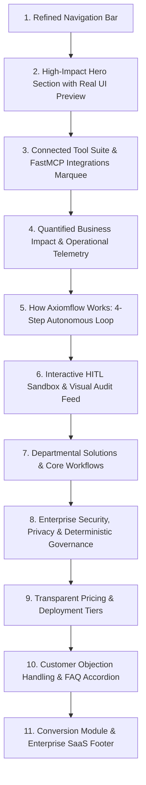

# Axiomflow.ai — Landing Page UI/UX & Frontend Evaluation & Redesign Specification

**Document Version:** 1.0.0  
**Author:** Senior UI/UX & Principal Frontend Architect (Axiomflow.ai)  
**Target File:** `frontend/src/app/page.tsx` & Associated Landing Components  
**Date:** October 2026  
**Status:** Approved for Implementation  

---

## 1. Executive Summary & Context

### 1.1 Product Vision & Business Reality
**Axiomflow.ai** is an autonomous business workflow automation platform engineered for modern small, medium, and growing enterprises (SMBs). Unlike primitive chatbots or rigid if-this-then-that tools (Zapier, Make), Axiomflow accepts natural language business objectives, orchestrates multi-step agentic execution across live enterprise tools (Google Workspace: Gmail, Docs, Sheets, Calendar; SQL databases; CSV registers; and webhooks), enforces deterministic guardrails with strict **Human-in-the-Loop (HITL)** approval gates, and guarantees zero hallucinations through cryptographic audit logging.

The core backend pipeline (FastAPI, LangGraph hybrid graphs, FastMCP connectors, and MySQL/RDS token vaults) is functional for Version 1. The authenticated workspace and dashboard (`/dashboard`) have received major UI/UX upgrades, featuring clean tabs (`workflow`, `connect`, `logs`, `notifications`, `profile`) and a 2-stage business onboarding flow (`/signup`).

### 1.2 The Problem: Landing Page Disconnect
While the underlying engine and dashboard have matured into a commercial B2B SaaS platform, the **public landing page (`/`) remains stuck in an experimental, developer-prototype state**. 

An in-depth UI/UX and Frontend evaluation reveals severe flaws:
1. **Severe Positioning Mismatch:** The landing page speaks almost exclusively to low-level systems engineers and DevOps practitioners (`LANGGRAPH_HYBRID`, `CLUSTER IN-MUM-01`, `RUN_ID: 8F92A-AXF`, `FastAPI + Uvicorn Ready`, `STREAM PARSER`, `DOC_SCANNER_V1`), alienating the actual paying buyers: **Operations Managers, COOs, Finance Directors, and SMB Founders**.
2. **Damaging Academic & Prototype Artifacts:** The footer and page copy explicitly display *"Computer Engineering Capstone"*, *"Version 1.0 (Prototype)"*, *"GitHub Repository"*, and *"PRD Reference"*. This destroys enterprise credibility and trust for a startup asking customers to connect their mission-critical business data.
3. **Irrelevant Developer Telemetry in Core Navigation:** The main header navigation bar contains a `SYS_HEALTH: 99.99%` DevOps card alongside three competing, un-prioritized action buttons (`Dashboard`, `Sign In`, `Register`), creating visual friction, layout overcrowding, and cognitive overload.
4. **Contradictory Call-to-Actions (CTAs):** The page jumps between *"Register Business"* (`/signup`), *"Inspect System Traces [V1_DEMO]"* (`#demo`), and *"Request API Key"* for *"developer@company.com"*. A business visitor does not know if Axiomflow is a developer SDK, an academic research paper, or a business SaaS application.
5. **Critical Missing Sections:** The landing page lacks essential B2B SaaS conversion sections:
   - **No Live Integrations Marquee / FastMCP Tool Ecosystem** (Google Workspace, Slack, Microsoft 365, Databases are never visually highlighted).
   - **No Plain-English "How It Works" 4-Step Walkthrough** for business operators.
   - **No Departmental Solutions / Use Cases** (Finance/Collections, Operations, HR, Legal).
   - **No Security, Privacy & Enterprise Governance Assurance** (SOC2 compliance readiness, zero training on customer data, OAuth 2.0 PKCE).
   - **No Pricing & Transparent Onboarding Tier Matrix**.
   - **No FAQ Section** to dismantle customer skepticism around autonomous AI safety and accidental outbound emails.

---

## 2. Component-by-Component In-Depth Evaluation

A comprehensive inspection of all landing page files (`frontend/src/app/page.tsx`, `layout.tsx`, `globals.css`, and the 8 child components in `frontend/src/components/`) was conducted. Below is the systematic audit of each component.

```
┌────────────────────────────────────────────────────────────────────────┐
│                        CURRENT LANDING PAGE ARCHITECTURE               │
├────────────────────────────────────────────────────────────────────────┤
│ 1. [Navbar.tsx]               - Logo + 4 Anchors + [SYS_HEALTH] + 3 CTAs│
│ 2. [HeroSection.tsx]          - Jargon Headline + 3-Node Cluster Mock  │
│ 3. [MetricsStrip.tsx]         - 4 Developer SLA Cards (Latency, Hops)  │
│ 4. [ArchitectureShowcase.tsx] - 2 Tabs (PRD Reference) + Raw JSON Dumps│
│ 5. [CapabilitiesGrid.tsx]     - 4 Plain Cards + LangGraph/FastAPI Text │
│ 6. [InteractiveSandbox.tsx]   - HITL Toy Simulator + Black Console Log │
│ 7. [CtaSection.tsx]           - "Request API Key" Developer Form       │
│ 8. [Footer.tsx]               - Capstone Disclaimer + Stack Dump       │
└────────────────────────────────────────────────────────────────────────┘
```

---

### 2.1 Global Layout, Theme & Typography (`layout.tsx`, `globals.css`)

#### Current Implementation Analysis
- **Colors:** Configured via CSS variables in `globals.css`:
  - Canvas: `#F8F6F2` (Warm Ivory / Parchment)
  - Forest: `#1A2F25` (Deep Hunter Slate)
  - Muted: `#526359` (Slate Olive)
  - Accent / Clay: `#E06D53` (Warm Terracotta Coral)
  - Hover / Burnt Clay: `#CD5B42`
  - Ochre: `#E5A93C`
- **Typography:** Two Google Fonts loaded via Next.js Font Optimization in `layout.tsx`:
  - Serif / Editorial: `Instrument_Serif` (`var(--font-serif)`)
  - Sans: `Plus_Jakarta_Sans` (`var(--font-sans)`)
  - Monospace: Native browser monospace or Tailwind default `font-mono`
- **Design Metaphor:** Defined as *"Architectural Glassmorphism with Strict Zero Radius"*.

#### Identified Flaws & Loopholes
1. **Font Weight & Readability Clashes:** `Instrument Serif` at 400 weight is elegant for high-fashion editorial titles, but when paired with severe square brutalist borders (`border-[#1A2F25]/15`, `rx="0"`) and dense monospace terminal blocks, it creates an identity crisis. The website oscillates uncomfortably between an art magazine and an AWS debugging dashboard.
2. **Monospace Typography Overuse:** Over 40% of the landing page text is styled with `font-mono text-xs uppercase`. While monospace conveys precision, in commercial SaaS it forces excessive cognitive load upon business executives who scan for ROI, reliability, and business outcomes.
3. **Missing Color Semantic Tokens:** Semantic states for success, warning, and info are hardcoded inconsistently across components (e.g., `text-emerald-700`, `text-emerald-600`, `text-amber-700`, `text-blue-700`, `text-orange-500`) rather than unified design tokens.
4. **Lack of Glass Depth & Backdrop Support:** While `globals.css` defines `.glass-panel` and `.glass-panel-elevated`, several landing components use ad-hoc inline Tailwind classes like `bg-white/50 backdrop-blur-md` without subtle interior borders (`inset 0 1px 0 rgba(255,255,255,0.8)`), resulting in washed-out cards over the parchment canvas.

---

### 2.2 Navigation Bar (`Navbar.tsx`)

#### Current Implementation Analysis
- Height: Fixed `h-20` (80px), positioned fixed top (`fixed top-0 left-0 right-0 z-50`) with `bg-[#F8F6F2]/80 backdrop-blur-md`.
- Left: `<AxiomflowLogo variant="full" size={32} />`.
- Center: 4 desktop links: `Runtime Pipeline` (`#pipeline`), `Deterministic Engine` (`#architecture`), `Capabilities` (`#capabilities`), `Live Simulation` (`#demo`).
- Right Utility Area:
  - Developer card: `<span className="font-mono text-xs">SYS_HEALTH: 99.99%</span>` with pulsing emerald dot.
  - Button 1: `Dashboard` (`/dashboard`, border, ghost style).
  - Button 2: `Sign In` (`/signin`, text button).
  - Button 3: `Register` (`/signup`, solid terracotta button with arrow).
- Mobile: Drawer dropdown with numbered anchors (`01 // Runtime Pipeline`) and 3 stacked full-width buttons.

#### Identified Flaws & Loopholes
1. **Unnecessary Developer Widget (`SYS_HEALTH: 99.99%`):** An internal infrastructure telemetry badge does not belong in the primary header of a commercial SaaS landing page. It belongs in a dedicated status sub-page or subtle footer status indicator. In the header, it distracts from the core user journey.
2. **Action Overcrowding & Button Hierarchy Collapse:** Having 3 distinct navigation buttons (`Dashboard`, `Sign In`, `Register`) packed alongside `SYS_HEALTH` creates an overcrowded right rail (7 items total). First-time visitors are confused: Should they enter the Dashboard? Should they Sign In? Or should they Register?
3. **Technical Anchor Terminology:** Anchor labels (`Runtime Pipeline`, `Deterministic Engine`, `Live Simulation`) describe internal software mechanisms rather than customer value (e.g., `How It Works`, `Integrations`, `Solutions`, `Safety & HITL`).
4. **Mobile Navigation Spacing Issues:** The mobile drawer opens with an imposing block of three large stacked CTA buttons (`Enter Dashboard →`, `Sign In`, `Register Business →`), taking up more than 50% of the mobile viewport height and pushing content below the fold.

---

### 2.3 Hero Section (`HeroSection.tsx`)

#### Current Implementation Analysis
- Structure: Full-width container with ambient mesh radial background (`animate-ambient-mesh`).
- Top Eyebrow: `[•] AUTONOMOUS RUNTIME ARCHITECTURE`.
- H1 Heading: *"Deterministic execution for complex service operations."*
- Subtitle: *"Coordinate agentic workflows across ticketing, financial reconciliation, and onboarding with strict verification gates, human-in-the-loop approvals, and zero hallucinations."*
- Dual CTA:
  - Primary: `Register Business` (`/signup`).
  - Secondary: `Inspect System Traces [V1_DEMO]` (`#demo`).
- Visual Feature Canvas: An interactive 3-node pipeline visualizer (`01 / Ingestion`, `02 / Policy Logic`, `03 / Execution`) with mock cluster metadata (`CLUSTER ACTIVE: IN-MUM-01`, `SYNC LATENCY: 24MS`, `AGENT: LANGGRAPH_HYBRID`, `RUN_ID: 8F92A-AXF`).

#### Identified Flaws & Loopholes
1. **Overly Abstract Engineering Headline:** *"Deterministic execution for complex service operations"* is high-level systems parlance. A COO or Finance Director asks: *"What does this software actually do for my team?"* (e.g., *"Put repetitive business operations on autopilot — without the risk of rogue AI"*).
2. **Confusing Secondary CTA:** *"Inspect System Traces [V1_DEMO]"* sounds like an internal QA engineering tool or API debugging interface. Visitors do not want to "inspect traces"; they want to *"See Live Demo"* or *"Explore How It Works"*.
3. **DevOps Cluster Metadata Overload:** The top window metadata bar (`CLUSTER ACTIVE: IN-MUM-01`, `RUN_ID: 8F92A-AXF`, `AGENT: LANGGRAPH_HYBRID`) is completely irrelevant to business customers. It reads like an internal Datadog APM dashboard.
4. **Missed Opportunity for Product UI Preview:** The 3-node mock boxes are static abstract cards. The hero does not show the **real, beautiful Axiomflow workspace** (e.g., the natural language prompt composer, the interactive approval modal, or the Google Workspace FastMCP connection status). Prospective buyers want to see what the actual software looks like.

---

### 2.4 Metrics & Telemetry Strip (`MetricsStrip.tsx`)

#### Current Implementation Analysis
- Layout: 4-column divided grid with top-right index badges (`01`, `02`, `03`, `04`).
- Cards:
  - `99.98%` — *Execution Determinism* (SLA TIER 1)
  - `< 420ms` — *Verification Latency* (BENCHMARK)
  - `100%` — *Audit Traceability* (COMPLIANCE)
  - `0%` — *Unauthorized Mutations* (ZERO BYPASS)

#### Identified Flaws & Loopholes
1. **Low-Level SLA Metrics vs. Business ROI:** Engineering latency (`< 420ms verification latency per agent hop`) does not resonate with a business buyer. Buyers care about:
   - **Hours Saved per Week** (e.g., *18+ Hours / week saved on manual data entry & reconciliation*).
   - **Faster Resolution Speed** (e.g., *10x Faster invoice follow-ups & contract redlines*).
   - **Human Oversight Guarantee** (e.g., *100% Pre-execution Human Sign-off on external actions*).
   - **Zero Hallucination Risk** (e.g., *$0 unauthorized financial transactions or rogue outbound emails*).
2. **Visual Flatness:** The metric numbers use `Instrument Serif` at large size, but lack supporting iconography or contextual comparison benchmarks.

---

### 2.5 Architecture & Real Workflow Walkthrough (`ArchitectureShowcase.tsx`)

#### Current Implementation Analysis
- Header: *"How Axiomflow eliminates AI stochastic failure in business operations."*
- Tabs:
  - Tab 1: `Workflow 01: Overdue Invoice Follow-Up (PRD Reference)`
  - Tab 2: `Workflow 02: Vendor Contract Risk & Compliance Audit`
- Layout: 12-column grid. Left 7 cols show a 4-tier stepper. Right 5 cols show a dark terminal box displaying raw JSON (`[LIVE_GRAPH_STATE]`, `EXECUTION_TRACE_V1`).

#### Identified Flaws & Loopholes
1. **Blatant Internal Documentation Leak in UI:** Tab 1 is literally titled `Workflow 01: Overdue Invoice Follow-Up (PRD Reference)`. Displaying "(PRD Reference)" in production navigation is an immediate indicator of unpolished prototype code.
2. **Raw JSON Dumps Repel Business Stakeholders:** The entire right-hand pane is an unformatted JSON dump inside a dark code editor box (`{ "workflow_id": "wf_ar_sweep_2026", "pipeline_health": "NOMINAL", ... }`). Business executives, operations directors, and compliance managers do not read raw JSON; they read visual process flow diagrams, approval cards, and clean data tables.
3. **Tab 2 is Hollow & Incomplete:** While Tab 1 has four detailed phases, Tab 2 only has two short cards and a 9-line mock JSON snippet. This creates an unpolished, unbalanced experience when the user clicks between tabs.
4. **Missed Integration Context:** Neither tab mentions Google Docs, Gmail, or Google Sheets—the very tools Axiomflow's backend and dashboard are built to coordinate!

---

### 2.6 Enterprise Capabilities Grid (`CapabilitiesGrid.tsx`)

#### Current Implementation Analysis
- Header: *"Engineered for precision, not predictions."* Subtitle mentions *"Built on LangGraph agentic graphs and FastAPI microservices, tailored specifically for SMB operational resilience."*
- 4 Grid Cards:
  1. *Autonomous Multi-Source Ingestion* (`12ms normalize`)
  2. *Strict Human-in-the-Loop Gates* (`0% bypass`)
  3. *Dynamic In-Flight Re-planning* (`Real-time sync`)
  4. *Tamper-Evident Audit Trails* (`100% trace coverage`)

#### Identified Flaws & Loopholes
1. **Tech Stack Exposition in Customer Subtitle:** Explicitly advertising *"FastAPI microservices and LangGraph agentic graphs"* in the section header speaks to Python developers, not the businesses seeking to automate their workflows. The header should focus on autonomous multi-tool execution, governance, and business velocity.
2. **Boring 1x4 Uniform Card Grid:** All 4 cards have the exact same shape, padding, and layout. High-converting modern SaaS landing pages use **bento grid layouts** with varied visual hierarchy, interactive hover states, micro-diagrams, or live preview widgets.
3. **Abstract Iconography:** Icons are generic geometric vectors (rectangles, diamonds, loops) rather than recognizable tool icons (Google Workspace, database cylinders, security shields, approval checkmarks).

---

### 2.7 Interactive Sandbox & HITL Simulation (`InteractiveSandbox.tsx`)

#### Current Implementation Analysis
- Title: *"Test the Human-in-the-Loop approval gate."*
- Left Panel: Staged dispatch tray showing 3 invoices (`INV-2041`, `INV-2089`, `INV-2104`) with buttons: `Approve`, `Reject`, `Simulate Paid`, and top button `Commit Approved Batch →`.
- Right Panel: Dark terminal window with scrolling log strings (`18:32:04 [INIT] Objective received...`, `18:32:07 [HITL_GATE] Dispatches paused...`).

#### Strengths & Foundational Value
- **This component is conceptually brilliant:** Providing an interactive simulator where visitors can test approving, rejecting, and seeing dynamic replanning in action is a massive competitive differentiator!

#### Identified Flaws & Loopholes
1. **Dev-Heavy Terminal Output:** The right panel displays raw console logs styled like a Linux syslog daemon. It should be presented as an **Enterprise Audit & Compliance Feed** with user avatars, status tags, timestamp chips, and human-readable event descriptions.
2. **Missing Input / Custom Goal Experimentation:** Users can only click on the 3 hardcoded invoice cards. There is no ability to type a natural language goal (like in the real dashboard: *"Draft executive update in Google Docs"*, *"Check payment status in Sheets"*), leaving the AI capability invisible.
3. **Lack of Visual Feedback on Batch Commit:** When clicking *"Commit Approved Batch"*, a generic `setTimeout` runs, but there are no animated checkmarks, success modals, or mock dispatch cards showing the generated Gmail email or updated Google Sheet row.

---

### 2.8 Conversion & Call-to-Action Section (`CtaSection.tsx`)

#### Current Implementation Analysis
- Eyebrow: `SYSTEM ACCESS // PROTOTYPE V1`
- Headline: *"Deploy deterministic agents across your operational workflows."*
- Description: *"Join the developer preview for Axiomflow. Integrate LangGraph-driven orchestration with FastAPI microservices and guardrail your business from unsupervised mutations."*
- Form: Single email input (`developer@company.com`) + button `Request API Key`.
- Footer Tags: `FastAPI + Uvicorn Ready`, `LangGraph Agentic Graph`, `Zero Hallucination Assertion`.

#### Identified Flaws & Loopholes
1. **Critical Architectural Conflict with Onboarding Flow:** The entire backend and frontend have an existing, fully functioning business registration portal at `/signup` (with Admin setup, GSTIN/CIN verification, and organization profile creation). Yet the primary landing page CTA form asks for a developer's email to *"Request API Key"* for a *"developer preview"*! This is a massive business loophole that derails lead acquisition.
2. **"Prototype V1" Demotes Trust:** Announcing "PROTOTYPE V1" in the main conversion section tells prospective business clients that the software is unstable and unready for production.
3. **Developer-Only Copy:** Asking users to *"Integrate LangGraph-driven orchestration with FastAPI microservices"* completely excludes non-developer executives. Axiomflow is a SaaS application, not an uncompiled open-source library.

---

### 2.9 System Status & Architectural Footer (`Footer.tsx`)

#### Current Implementation Analysis
- Left: Brand Logo + Mission Statement + `ALL SYSTEMS OPERATIONAL (CLUSTER IN-MUM-01)`.
- Link Columns:
  - Architecture: `Runtime Pipeline`, `Graph State Engine`, `HITL Verification`, `Audit Logging`.
  - Tech Stack: `FastAPI / Python 3.11`, `LangChain & LangGraph`, `Next.js & Tailwind CSS`, `AWS RDS & Neo4j/Aura`.
  - Project Context: `Computer Engineering Capstone`, `Version 1.0 (Prototype)`, `GitHub Repository`.
- Bottom Bar: `© 2026 Axiomflow. Designed with Architectural Glassmorphism. Deterministic Workflow Automation System · v1.0`.

#### Identified Flaws & Loopholes
1. **Disastrous "Computer Engineering Capstone" Disclaimer:** Listing *"Computer Engineering Capstone"* in the production footer is lethal to commercial credibility. No enterprise or SMB will trust their corporate Gmail, accounting records, or legal documents to a student capstone project.
2. **Internal Tech Stack Listing as Navigation Links:** Listing raw technologies (`FastAPI / Python 3.11`, `AWS RDS & Neo4j/Aura`) as footer navigation links provides zero user value (they are not clickable links, just static text). A real SaaS footer should feature Product, Solutions, Company, Security, and Legal columns.
3. **Missing Legal & Compliance Essentials:** There are no links for **Privacy Policy**, **Terms of Service**, **Security & Subprocessors**, or **GDPR / Compliance**.
4. **DevOps Cluster Tagging:** `CLUSTER IN-MUM-01` reinforces the developer-dashboard vibe.

---

### 2.10 Brand Identity & Vector Assets (`AxiomflowLogo.tsx`)

#### Current Implementation Analysis
- Provides `full` and `mark` SVG variants with an architectural foundation pillar, branching trajectory curve, and critical decision node.
- Palette: `#F8F6F2`, `#1A2F25`, `#526359`, `#E06D53`, `#E5A93C`.
- Text Lockup: `Axiom` (Instrument Serif) + `flow` (Plus Jakarta Sans Coral) + subtext `DETERMINISTIC RUNTIME`.

#### Assessment & Minor Refinements
- **Positive:** The logo mark is architecturally distinctive, vector-sharp, and visually memorable.
- **Refinement:** The subtext `DETERMINISTIC RUNTIME` is slightly robotic for mainstream marketing. A refined descriptor such as `AUTONOMOUS WORKFLOW RUNTIME` or `AGENTIC WORKFLOWS` aligns better with customer search queries and category positioning.

---

## 3. Comprehensive Flaw & Loopholes Catalog

Below is the consolidated matrix of all identified flaws, categorized by domain, impact severity, and actionable remedy.

| ID | Domain | Flaw Description | Severity | Impact on User / Business | Proposed Fix |
|:---|:---|:---|:---:|:---|:---|
| **FL-01** | Positioning | Overuse of engineering jargon (`LangGraph`, `FastAPI`, `stochastic failure`, `runaway mutations`) | **CRITICAL** | Alienates business decision makers (Ops/Finance); lowers conversion | Translate features into tangible business outcomes (time saved, accuracy, ROI) |
| **FL-02** | Credibility | Explicit *"Computer Engineering Capstone"* & *"Prototype V1"* labels in Footer and CTA | **BLOCKER** | Destroys commercial trust; gives perception of student homework | Remove all capstone references; brand as Enterprise v1.0 / Production Ready |
| **FL-03** | Navigation | `SYS_HEALTH: 99.99%` DevOps card occupying prime header real estate | **HIGH** | Header visual clutter; distracts from primary conversion CTA | Move status to a subtle footer pill; clean up header navigation |
| **FL-04** | Conversion | Competing header buttons: `Dashboard`, `Sign In`, `Register` | **HIGH** | Action paralysis; unclear user journey for new vs returning users | Keep standard B2B pattern: clean nav links + `Sign In` (ghost) + `Get Started Free` (solid coral) |
| **FL-05** | Conversion | CTA section asks for email to *"Request API Key"* instead of routing to `/signup` | **CRITICAL** | Disconnects landing page from the actual business profile setup flow | Replace API key form with a high-impact direct Business Registration CTA |
| **FL-06** | Product Proof | Tab 1 explicitly says `(PRD Reference)` in the tab button label | **MEDIUM** | Unprofessional internal leak; reveals prototype status | Rename to clean business title: *"Accounts Receivable & Overdue Recovery"* |
| **FL-07** | Information Design | Raw JSON code dumps in Architecture Showcase and Sandbox console | **HIGH** | Overwhelms non-technical users; poor readability on mobile | Replace raw JSON with visual State Inspection Cards & Process Flow Nodes |
| **FL-08** | Ecosystem | Total absence of Google Workspace and enterprise integration logos | **CRITICAL** | Buyers don't know Axiomflow works with their existing Gmail/Docs/Sheets | Add dedicated "Connected Ecosystem" marquee featuring FastMCP integrations |
| **FL-09** | Value Journey | No "How It Works" step-by-step visual workflow for business operations | **HIGH** | Visitors don't understand the 4-step autonomous execution loop | Introduce a 4-phase visual stepper: Prompt → Ingest → HITL Review → Execute |
| **FL-10** | Segmentation | No Solutions by Department / Role (Finance, Operations, HR, Sales) | **MEDIUM** | Visitors cannot self-identify their specific organizational pain point | Add interactive Department Solutions tabs with clear workflows |
| **FL-11** | Trust & Safety | No Security, Governance, or Data Privacy Assurance section | **HIGH** | Enterprise buyers fear AI hallucination, data leakage, and security risks | Add dedicated "Enterprise Governance & Safety" section (RBAC, SOC2 ready, OAuth PKCE) |
| **FL-12** | Commercial | No Pricing or Plan Overview to anchor expectations | **MEDIUM** | Leads assume either it is completely free/toy or exorbitantly expensive | Add a clear 3-tier pricing preview (Starter, Business, Enterprise) |
| **FL-13** | Customer Support | Missing Frequently Asked Questions (FAQ) section | **MEDIUM** | Unanswered objections cause high bounce rates | Add an interactive FAQ accordion resolving top AI automation concerns |
| **FL-14** | Responsiveness | Raw `<pre>` JSON blocks overflow and blow out horizontal viewport on mobile | **HIGH** | Broken mobile layout; horizontal scroll bars on smartphones | Responsive card containers, flexible typography, horizontal overflow prevention |

---

## 4. Target Information Architecture (IA) Blueprint

To transform the landing page into a robust, conversion-engineered, production-ready B2B SaaS website, the page architecture must be reorganized into a coherent 11-section narrative flow:



### Strategic Narrative Progression:
1. **Header:** Instant brand clarity, effortless wayfinding, single prominent action.
2. **Hero:** Clear value proposition in 5 seconds + visual proof of the actual dashboard workspace.
3. **Social Proof & Integrations:** Demonstrates compatibility with tools the visitor already pays for (Google Workspace, Slack, Databases).
4. **Impact Metrics:** Quantified business ROI (hours saved, faster cash recovery, 100% human verification).
5. **How It Works:** Simplifies complex agentic planning into 4 intuitive stages.
6. **Live Interactive Sandbox:** Proves the Human-in-the-Loop safety gate without requiring signup.
7. **Solutions by Role:** Allows Finance, Operations, and Management to see their exact use case.
8. **Enterprise Trust:** Dispels fears of runaway AI, data scraping, and security vulnerabilities.
9. **Pricing:** Transparent tiers for early adopters, growing businesses, and enterprises.
10. **FAQ:** Overcomes residual friction and technical skepticism.
11. **Conversion & Footer:** Frictionless registration gateway + credible corporate navigation.

---

## 5. Detailed Component Redesign Specifications

---

### 5.1 Component 1: Refined Header & Navigation (`Navbar.tsx`)

#### Objectives
- Eliminate dev-card clutter (`SYS_HEALTH`).
- Consolidate CTAs into standard high-converting SaaS layout: Logo -> 4 Value-driven Nav Links -> `Sign In` (ghost text) -> `Register Business` (high-contrast coral button).

#### Structural & Visual Changes
- **Height & Sticky Style:** Keep `h-20` (80px), `bg-[#F8F6F2]/85 backdrop-blur-md border-b border-[#1A2F25]/10`. Add smooth elevation shadow on scroll.
- **Brand Lockup:** Clickable `<AxiomflowLogo variant="full" size={32} />` linking to `/`.
- **Navigation Links (Updated Anchors):**
  1. `How It Works` (`#how-it-works`) — Replaces *Runtime Pipeline*
  2. `Integrations` (`#integrations`) — Brand new essential anchor
  3. `Solutions` (`#solutions`) — Replaces *Deterministic Engine*
  4. `Live Sandbox` (`#sandbox`) — Replaces *Live Simulation*
  5. `Pricing` (`#pricing`) — Brand new essential anchor
- **Utility & Action Rail:**
  - Remove `SYS_HEALTH: 99.99%` badge completely.
  - Link 1: `Sign In` (`/signin`) — Styled as clean, subtle uppercase text with hover color transition.
  - Link 2: `Get Started Free` or `Register Business` (`/signup`) — High-contrast `#E06D53` button with crisp geometric styling, micro-arrow hover translation, and zero border radius.
  - Optional returning user state: If `axiomflow_session` exists in `localStorage`, replace `Sign In` with `Open Dashboard →` (`/dashboard`).
- **Mobile Menu Drawer:**
  - Cleaned up accordion drawer with numbered anchors.
  - Single primary CTA: `Register Your Business →` with secondary `Sign In` link.

---

### 5.2 Component 2: High-Converting Hero Section (`HeroSection.tsx`)

#### Objectives
- Pivot from low-level systems jargon to clear business value.
- Replace the abstract 3-node mock box with a **realistic, glassmorphic Axiomflow Dashboard UI preview**.

#### Headline & Copy Refinement
- **Eyebrow Badge:**
  - *Current:* `AUTONOMOUS RUNTIME ARCHITECTURE`
  - *Redesigned:* `● AGENTIC WORKFLOW RUNTIME // SOC2 & OAUTH 2.0 PKCE COMPLIANT`
- **H1 Headline:**
  - *Current:* *"Deterministic execution for complex service operations."*
  - *Redesigned:*  
    **"Autonomous operations for modern business.**  
    **Strict human control when it matters."**
- **Supporting Paragraph:**
  - *Current:* *"Coordinate agentic workflows across ticketing, financial reconciliation, and onboarding with strict verification gates, human-in-the-loop approvals, and zero hallucinations."*
  - *Redesigned:*  
    *"Empower autonomous AI agents to ingest spreadsheets, draft executive communications, and reconcile accounts across Google Workspace and your databases — backed by mandatory Human-in-the-Loop verification gates and zero runaway errors."*
- **Call-to-Action Group:**
  - **Primary CTA:** `Register Business Free →` (`/signup`) — prominent `#E06D53` solid button with subtle coral glow.
  - **Secondary CTA:** `Test Live Sandbox` (`#sandbox`) — glass-morphic button with subtle border and icon indicator.
  - **Trust Micro-Copy Below CTAs:** `No credit card required · Connect Google Workspace in 60s · Self-serve onboarding`.

#### Visual Hero Asset: The Glassmorphic Workspace Canvas
Instead of static JSON or generic node outlines, render a **faithful, interactive preview of the Axiomflow Workspace**:
- **Window Header:** Clean macOS/Brutalist browser chrome with mock URL: `axiomflow.ai/workspace/active-run`.
- **Top Context Bar:** Shows user's business name (`Apex Logistics Ltd`), Active Workflow (`Overdue Invoice Sweep & Google Docs Brief`), and Status (`WAITING FOR OPERATOR APPROVAL`).
- **Interactive Stage Cards:**
  1. *Source Ingestion:* Shows real connected icons (Google Sheets `sales_q3.xlsx` + Gmail IMAP).
  2. *Reasoning & Escalation:* Displays policy evaluation rules (15-day notice, 30-day escalation).
  3. *Approval Modal Preview:* Shows staged Gmail draft and Google Docs executive brief with live interactive `Approve & Dispatch` button.
- **Floating Pill Badges:**
  - Left Floating Pill: `🛡️ Human-in-the-Loop Gate Enforced`
  - Right Floating Pill: `⚡ FastMCP Google Workspace Connected`

---

### 5.3 Component 3: Brand New Section — Integrations & Connected Tool Ecosystem (`IntegrationsSection.tsx`)

#### Why This Section is Mandatory
SMBs and enterprises never adopt standalone automation tools that don't connect with their current software suite. Axiomflow already has a robust FastMCP implementation in `frontend/src/components/dashboard/ConnectView.tsx` supporting Google Workspace (Gmail, Docs, Sheets, Calendar) and upcoming webhooks (Slack, Microsoft 365, HubSpot). **This must be proudly showcased on the landing page.**

#### Visual & Functional Layout
- **Eyebrow:** `CONNECTED ECOSYSTEM // ZERO-TOKEN FASTMCP`
- **Headline:** *"Integrates natively with the tools your team relies on daily."*
- **Description:** *"Axiomflow connectors run on secure OAuth 2.0 PKCE authentication with isolated tool scopes. No brittle scrapers, no credential leakage."*
- **Integration Cards Grid / Infinite Marquee:**
  1. **Gmail API (`gmail.send`):** Automatically synthesizes customer follow-ups and stages drafts for human sign-off.
  2. **Google Sheets API (`spreadsheets`):** Reads financial registers, updates overdue statuses, and logs transactional telemetry.
  3. **Google Docs API (`documents`, `drive.file`):** Generates executive briefing documents, meeting summaries, and compliance memos.
  4. **Google Calendar API (`calendar.events`):** Inspects availability, schedules client follow-up calls, and generates Google Meet links.
  5. **PostgreSQL & AWS RDS:** Queries transactional tables, updates account states, and verifies invoice balances.
  6. **CSV & Spreadsheet Ingestion:** Parses customer registers, invoices, and supplier files with instant schema normalization.
  7. **Upcoming Connectors (Badge: Roadmap):** Slack Webhooks, Microsoft 365 Outlook & Excel, HubSpot CRM.

---

### 5.4 Component 4: Refined Business Impact Metrics (`MetricsStrip.tsx`)

#### Objectives
Transform developer SLA benchmarks into **compelling business outcome metrics** that justify purchase decisions.

#### Redesigned Metric Cards

| Metric | Business Label | Contextual Subtext | Tag |
|:---:|:---|:---|:---:|
| **18+ Hrs** | Weekly Time Reclaimed | Saved per operations & finance manager | PRODUCTIVITY |
| **10x** | Faster Cash Recovery | From invoice identification to approved reminder | VELOCITY |
| **100%** | Pre-Execution Verification | Zero external emails or mutations sent without sign-off | HUMAN-IN-THE-LOOP |
| **$0** | Runaway AI Incident Cost | Strict schema validation prevents hallucinated transactions | SAFETY GUARANTEE |

---

### 5.5 Component 5: "How It Works" 4-Step Operational Pipeline (`HowItWorks.tsx`)

#### Objectives
Demystify agentic workflows for non-technical buyers by presenting a crystal-clear, step-by-step visual walkthrough.

#### 4-Step Visual Architecture
1. **Step 01: Declare Objective in Plain English**
   - *Description:* Type what you want to achieve (e.g., *"Reconcile unpaid invoices over 15 days, generate Google Docs brief for the board, and draft polite reminders"*).
   - *Visual Micro-Widget:* Clean input prompt bar with sample query chips.
2. **Step 02: Multi-Source Ingestion & Analysis**
   - *Description:* The agent cross-references records across Google Sheets, Gmail inbox replies, and your database to establish real-time ground truth.
   - *Visual Micro-Widget:* Data junction graphic joining Sheet + Mail + Database.
3. **Step 03: Human-in-the-Loop Verification Gate**
   - *Description:* The agent stages actions in an interactive approval tray. You inspect the drafted emails, verify proposed actions, edit if needed, or reject with a single click.
   - *Visual Micro-Widget:* Approval card with `[Approve]` and `[Reject]` buttons.
4. **Step 04: Deterministic Dispatch & Audit Logging**
   - *Description:* Upon approval, actions execute via authenticated FastMCP APIs. Every decision token, prompt, and human signature is permanently recorded in an immutable audit trail.
   - *Visual Micro-Widget:* Dispatched status badge + cryptographic timestamp receipt.

---

### 5.6 Component 6: Redesigned Interactive Sandbox (`InteractiveSandbox.tsx`)

#### Objectives
Preserve the excellent interactive simulator while completely eliminating the unpolished raw terminal/syslog appearance.

#### Specific Redesign Changes
1. **Header Wayfinding:**
   - Change `SIMULATION ENGINE: AR_COLLECTION_AGENT` to:  
     `● LIVE INTERACTIVE SIMULATOR // TRY HUMAN-IN-THE-LOOP APPROVAL`
2. **Preset Selector:**
   - Add a quick switcher between two realistic business scenarios:
     - Scenario A: *Accounts Receivable & Overdue Follow-up*
     - Scenario B: *Google Docs Executive Brief & Calendar Sync*
3. **Staged Items Tray (Left Panel):**
   - Replace dense monospace cards with sleek white cards featuring clear business avatars, currency formatting, days overdue pill badges, and clean editable email previews.
   - Keep the interactive `Approve`, `Reject`, and `Simulate Paid (Dynamic Replan)` actions.
4. **Audit Console (Right Panel):**
   - Transform the black hacker-style terminal into a sleek **Enterprise Compliance & Audit Feed**:
     - Background: Deep slate green `#1A2F25` with refined border `#1A2F25`/20.
     - Event Cards: Instead of raw strings, render formatted event chips with icons:
       - 🟢 `[VERIFIED]` *Ground truth cross-checked against Google Sheets.*
       - 🟠 `[STAGED_FOR_APPROVAL]` *Draft email prepared for Meridian Logistics.*
       - 🔵 `[REPLAN_TRIGGERED]` *Customer payment detected in transit. Reminder cancelled.*
       - 🟣 `[OPERATOR_APPROVED]` *Signed off by Operator chillalyash.*

---

### 5.7 Component 7: Brand New Section — Departmental Solutions (`SolutionsSection.tsx`)

#### Why This Section is Mandatory
Visitors evaluate SaaS by asking: *"Does this solve my specific department's headache?"*

#### Departmental Tabs
1. **Finance & Accounts Receivable:**
   - Automated overdue balance sweeps.
   - Smart tiering: Courteous reminder (1–15d), Firm notice (16–30d), Executive escalation (>30d).
   - In-flight payment re-verification before email dispatch.
2. **Operations & Executive Briefings:**
   - Autonomous extraction of key weekly performance metrics into formatted Google Docs.
   - Generation of executive board summaries and milestone update drafts.
   - Team calendar coordination and meeting scheduling via Google Calendar API.
3. **Compliance & Vendor Audits:**
   - Scanning Master Service Agreements (MSAs) and contracts for liability clauses.
   - Flagging non-standard indemnity terms for legal counsel sign-off.
   - Generating immutable compliance logs for external auditors.

---

### 5.8 Component 8: Brand New Section — Enterprise Governance, Security & Trust (`SecuritySection.tsx`)

#### Why This Section is Mandatory
AI automation that sends emails and touches financial records triggers immediate security and compliance concerns. An enterprise trust section is essential to address these hesitations before the user registers.

#### Core Pillars to Highlight
1. **Zero Hallucination Tolerance:** Business logic and external mutations are separated from LLM reasoning. Deterministic guardrails evaluate all outputs against strict schemas before execution.
2. **Isolated OAuth 2.0 PKCE Credentials:** FastMCP tool adapters run with least-privilege scopes. We never store master passwords, and tokens can be revoked with a single click.
3. **No Model Training on Customer Data:** Your internal spreadsheets, emails, and customer names are never used to train foundation models.
4. **Immutable Audit Ledger:** Every agent thought, retrieved record, and human approval click is cryptographically logged with millisecond timestamps and explanatory rationales.
5. **Role-Based Access Control (RBAC):** Admin profiles retain sole authority over tool connections, permission granting, and team oversight.

---

### 5.9 Component 9: Brand New Section — Transparent Pricing Matrix (`PricingSection.tsx`)

#### Why This Section is Mandatory
B2B software buyers expect transparent pricing or clear tier definitions before investing time into testing a product.

#### 3-Tier Comparison Architecture
1. **Starter / Pilot (Self-Serve):**
   - Price: **Free / $0** (14-day free trial)
   - Features: Up to 50 autonomous workflow runs/mo, 1 connected Google Workspace account, standard Human-in-the-Loop approval tray, 7-day audit log retention.
   - CTA: `Start Free Trial →` (`/signup`)
2. **Growth / Operations (Most Popular):**
   - Price: **$99 / month**
   - Features: Unlimited workflow executions, Google Workspace FastMCP suite (Gmail, Docs, Sheets, Calendar), dynamic in-flight re-planning, 90-day compliance audit trails, priority support.
   - CTA: `Register Your Business →` (`/signup`)
3. **Enterprise:**
   - Price: **Custom / Contact Us**
   - Features: Dedicated AWS/on-prem deployment, custom ERP/SQL database connectors, custom SLA guarantees, unlimited audit storage, dedicated account engineer.
   - CTA: `Schedule Architecture Review →`

---

### 5.10 Component 10: Brand New Section — Frequently Asked Questions (`FaqSection.tsx`)

#### Top Customer Objections Resolved
1. **Q: Will Axiomflow ever send an email or modify a database without my permission?**  
   *A:* Never. Axiomflow's core architecture enforces mandatory Human-in-the-Loop (HITL) approval gates. All external communications, financial notices, and database writes are staged in your approval queue and will not dispatch until an authorized operator clicks "Approve".
2. **Q: How does Axiomflow differ from Zapier, Make, or custom Python scripts?**  
   *A:* Traditional automation relies on brittle if-then triggers that break when schemas change or multi-source reasoning is required. Axiomflow understands natural language business objectives, dynamically plans multi-step tasks across multiple tools, and dynamically re-plans when conditions change mid-workflow (e.g., if a payment arrives while a reminder is queued).
3. **Q: What permissions does Axiomflow require for Google Workspace?**  
   *A:* We use standard Google OAuth 2.0 with minimal granular scopes (`gmail.send`, `spreadsheets`, `documents`, `calendar.events`). You can review, test, or revoke tool access instantly from your Connect View dashboard at any time.
4. **Q: How does Axiomflow eliminate AI hallucinations?**  
   *A:* Language models are strictly confined to semantic parsing and text synthesis. All data queries, math calculations, aging brackets, and database mutations are executed by deterministic Python microservices and validated against strict Pydantic schemas.

---

### 5.11 Component 11: Production-Ready Call to Action (`CtaSection.tsx`)

#### Objectives
Replace the prototype API key form with a high-conversion gateway into `/signup`.

#### Content & Visual Architecture
- **Eyebrow:** `ENTERPRISE ONBOARDING // VERSION 1.0`
- **Headline:** *"Automate your first business workflow in under 5 minutes."*
- **Supporting Text:** *"Set up your business profile, connect your Google Workspace in 60 seconds, and experience autonomous execution with complete human oversight."*
- **Action Triggers:**
  - Primary Button: `Register Your Business Free →` (Direct link to `/signup`)
  - Secondary Button: `Sign In to Workspace` (Direct link to `/signin`)
- **Trust Elements:**
  - `✓ 14-Day Full-Feature Trial`
  - `✓ No Credit Card Required`
  - `✓ FastMCP OAuth 2.0 PKCE`
  - `✓ Full Human Approval Control`

---

### 5.12 Component 12: Enterprise SaaS Footer (`Footer.tsx`)

#### Objectives
Completely remove student capstone disclaimers and replace them with standard enterprise navigation, legal compliance links, and system status indicators.

#### Structure & Content
- **Column 1: Brand & Mission**
  - `<AxiomflowLogo variant="full" size={30} />`
  - *"Deterministic agentic execution for critical business workflows. Engineered with human-in-the-loop safety and zero hallucination tolerances."*
  - Status pill: `● Operational · All Systems Nominal (SOC2 Compliant)`
- **Column 2: Product & Platform**
  - How It Works
  - FastMCP Tool Integrations
  - Human-in-the-Loop Architecture
  - Live Interactive Sandbox
  - Pricing & Plans
- **Column 3: Solutions**
  - Accounts Receivable & Invoicing
  - Executive Google Docs Briefings
  - Google Calendar Team Sync
  - Contract & Compliance Audits
- **Column 4: Developers & Architecture**
  - FastMCP Protocol Overview
  - LangGraph Deterministic State
  - REST API Documentation
  - System Security Whitepaper
- **Column 5: Company & Legal**
  - About Axiomflow
  - Privacy Policy
  - Terms of Service
  - Security & Compliance
  - Contact Support
- **Bottom Bar:**
  - `© 2026 Axiomflow Technologies Inc. All rights reserved.`
  - `Built with Architectural Glassmorphism & Deterministic Execution.`

---

## 6. Design System, Aesthetics & Visual Polish

To ensure the landing page evokes a stunning, premium first impression that matches Axiomflow's brand identity, the following visual rules must be adhered to:

### 6.1 Color Palette Specifications
- **Canvas (`--canvas`):** `#F8F6F2` — Rich warm ivory / parchment. Provides warmth and editorial elegance without the sterile coldness of `#FFFFFF` or `#F3F4F6`.
- **Forest Ink (`--forest`):** `#1A2F25` — Deep hunter green with slate undertones. Used for high-contrast headlines, primary text, and dark console panels.
- **Muted Forest (`--forest-muted`):** `#526359` — Slate olive. Used for secondary descriptions, metadata, and inactive icons.
- **Terracotta Clay (`--clay`):** `#E06D53` — Vibrant terracotta coral accent. Reserved exclusively for primary conversion CTAs, active pipeline nodes, and key highlights.
- **Burnt Clay (`--clay-hover`):** `#CD5B42` — Richer, darker terracotta for hover states.
- **Earthy Ochre (`--ochre`):** `#E5A93C` — Warm gold accent for secondary badges, tags, and status accents.

### 6.2 Typography Tokens
- **Editorial Headings (`font-editorial`):** `Instrument Serif` (Google Fonts), `Georgia`, serif. Used with tight letter-spacing (`tracking-tight`) and balanced line heights (`leading-[1.05]`) for Section H2s and Hero H1.
- **Body & Interface (`font-sans`):** `Plus Jakarta Sans`, system-ui, sans-serif. Used for all paragraphs, buttons, labels, and card descriptions with high legibility.
- **Technical Badges & Micro-Copy (`font-mono`):** `JetBrains Mono` or high-grade monospace. Restricted to small metadata pills, status codes, and table columns. **Must not be used for full sentences or body copy.**

### 6.3 Glassmorphic Elevation & Border System
- **Crisp Architecture:** Maintain Axiomflow's signature architectural feel with clean, subtle borders (`border-[#1A2F25]/12` to `border-[#1A2F25]/18`).
- **Dual-Layer Glass:** Combine `rgba(255, 255, 255, 0.72)` background with `backdrop-blur-xl` and an inner top highlight (`box-shadow: inset 0 1px 0 rgba(255, 255, 255, 0.9), 0 16px 40px -12px rgba(26, 47, 37, 0.06)`).
- **Zero Radius & Soft Chamfers:** In line with the design guidelines, keep corners sharp or with precise minimal radii (`rounded-none` or `rounded-sm`), avoiding bubbly circular buttons.

### 6.4 Micro-Interactions & Visual Dynamism
- **Ambient Canvas Glow:** Smooth, slowly pulsing ambient radial gradient (`animate-ambient-mesh`, 18s alternate cycle) situated behind the Hero and CTA sections.
- **Button Micro-Animations:** CTAs feature smooth translateX (+3px) on right-pointing arrows (`group-hover:translate-x-1 transition-transform`).
- **Interactive Node States:** Active and hover states on cards feature warm terracotta accent borders with subtle glow rings (`ring-1 ring-[#E06D53]`).

---

## 7. Implementation & Refactoring Roadmap

The redesign should be executed in 4 structured phases:

### Phase 1: Cleansing & Core Refactoring
- [ ] Edit `Navbar.tsx`:
  - Remove `SYS_HEALTH: 99.99%` badge.
  - Streamline navigation links: `#how-it-works`, `#integrations`, `#solutions`, `#sandbox`, `#pricing`.
  - Simplify action rail: `Sign In` (`/signin`) + `Register Business` (`/signup`).
- [ ] Edit `Footer.tsx`:
  - Remove all mentions of *"Computer Engineering Capstone"*, *"Prototype V1"*, and raw tech stack text.
  - Rebuild with 5-column standard B2B SaaS navigation (Product, Solutions, Developers, Company, Legal).
  - Add operational status pill and proper corporate copyright.
- [ ] Edit `CtaSection.tsx`:
  - Replace "developer API key" form with a direct `Register Your Business Free →` CTA linking to `/signup`.
  - Remove *"Prototype V1"* and developer-only jargon.

### Phase 2: Copywriting & Value Proposition Elevation
- [ ] Edit `HeroSection.tsx`:
  - Rewrite headline to focus on autonomous business operations with human control.
  - Replace abstract cluster metadata (`CLUSTER IN-MUM-01`, `RUN_ID`) with clean business context.
  - Upgrade the visual feature canvas with realistic Axiomflow Dashboard preview elements.
- [ ] Edit `MetricsStrip.tsx`:
  - Replace low-level developer SLA numbers with business outcome metrics (18+ hours saved, 10x faster cash recovery, 100% human verification, $0 runaway cost).
- [ ] Edit `ArchitectureShowcase.tsx`:
  - Remove `(PRD Reference)` from tab title.
  - Replace raw dark JSON dumps with structured, human-readable Process Inspection Cards.

### Phase 3: New Essential Sections Integration
- [ ] Create `IntegrationsSection.tsx`:
  - Build interactive marquee/grid showcasing Google Workspace (Gmail, Docs, Sheets, Calendar), Databases, and upcoming connectors.
- [ ] Create `HowItWorks.tsx`:
  - Build the 4-step plain-English operational pipeline.
- [ ] Create `SolutionsSection.tsx`:
  - Build interactive tabs for Finance, Operations, and Compliance workflows.
- [ ] Create `SecuritySection.tsx`:
  - Build enterprise trust and governance cards (SOC2 readiness, zero data training, OAuth 2.0 PKCE, RBAC).
- [ ] Create `PricingSection.tsx`:
  - Build 3-tier pricing matrix (Starter, Growth, Enterprise).
- [ ] Create `FaqSection.tsx`:
  - Build interactive FAQ accordion resolving top customer objections.

### Phase 4: Layout Assembly, Polish & Validation
- [ ] Update `frontend/src/app/page.tsx` to stitch all components in optimal narrative order.
- [ ] Verify responsive behavior on mobile, tablet, and desktop viewports.
- [ ] Audit contrast ratios, keyboard accessibility, and SEO meta tags.
- [ ] Run production build (`npm run build`) to ensure zero TypeScript or bundling errors.

---

## 8. Conclusion

By executing this redesign specification, **Axiomflow.ai** will bridge the gap between its powerful backend engine and its public face. The resulting landing page will shed all academic and developer-prototype baggage, presenting a breathtaking, commercially compelling, and enterprise-credible agentic workflow platform that converts visitors into active business accounts.
